# uma-memo アーキテクチャ・コスト・技術選定

[product.md](./product.md) が「何を作るか」なのに対し、こちらは「どう動き、いくらかかり、なぜその技術か」をまとめたもの。

作成日: 2026-09-20 / 最終更新日: 2026-10-12

- **読む場面:** コードを変えるなら毎回 第0章。ほかは触る場所に合わせて章だけ読む
  - サーバー側（ルートの `.server.ts`・サービス層・DB）、依存の向き → 第2章・第3章（3-1〜3-6）
  - 共有ページ・共有の画像（OGP） → 3-7
  - オッズの取得 → 3-8、出走馬の取得（Cron・管理画面） → 3-9、MCP と OAuth → 3-10（詳細は [mcp.md](./mcp.md)）
  - デプロイと環境（local / staging / production） → 第4章、採用技術 → 第5章、コスト・上限 → 第6章・第7章
- **ここに無いもの:** ルートの一覧と action の約束は [api.md](./api.md)、画面側の書き方は
  [frontend.md](./frontend.md)、MCP・OAuth・WebMCP は [mcp.md](./mcp.md)、テーブルと列は [data-model.md](./data-model.md)、
  出走馬データ（YAML）の書式は [data/README.md](../data/README.md)、Cloudflare の構築とデプロイの手順は [operations.md](./operations.md)、
  ステージングは [staging.md](./staging.md)、ログと通知は [monitoring.md](./monitoring.md)、
  依存の規則を機械で止める仕組みは [harness.md 第2層](./harness.md)
- 料金・制限の出典: Cloudflare 公式ドキュメント（Workers Paid の数字で確認）
  - [Workers Pricing](https://developers.cloudflare.com/workers/platform/pricing/)
  - [D1 Limits](https://developers.cloudflare.com/d1/platform/limits/)

---

## 0. 守ること

破ると本番で他人のメモが漏れるか、Workers で壊れるもの。理由は括弧の先の章にある。

### ランタイムと入口

- **D1 クライアントはリクエストごとに `createDb(platform.env, locals.monitor.onQuery)` で作る**（ルートは `ctx()` を通せば済む）。
  モジュールスコープに接続やユーザー情報を持たせない。Workers の実行環境は複数のリクエストで使い回される（→ 3-1）
- **認証の判断は `src/hooks.server.ts` に閉じる。** ルートは `locals.user` だけを見る。
  ログイン不要のパスは `PUBLIC_PATHS` にあるものだけ（→ [api.md 第2章](./api.md)）。
  例外は OAuth のトークンの口 `/oauth/token` だけで、`src/worker.js` が SvelteKit より先に受け、コード・PKCE・
  リフレッシュトークンで判断する（Cookie を見ない。`PUBLIC_PATHS` には足さない。→ [mcp.md 第1章](./mcp.md)）
- **`/mcp` は Bearer（OAuth のアクセストークン）だけで入り、Bearer は `/mcp` でしか効かない。**
  `/mcp` で Cookie を見ると他サイトから本人として叩かれ（CSRF）、画面で Bearer を見ると漏れたトークンで画面に入られる。
  MCP の tool の `viewerId` はトークンの持ち主で、入力からは受けない（→ [mcp.md](./mcp.md)）
- **依存は一方向。** サービス層（`src/lib/server/services/`）は SvelteKit を import しない。
  画面側はサーバーのコードを型ですら import しない（→ 第2章）
- 1リクエストの D1 クエリは10以内。超えそうなら JOIN か `batch()` にまとめる（→ 7-1）
- **セッショントークンは DB に平文で入れない。** 保存するのは SHA-256 ハッシュだけ
- `nodejs_compat` は付けない（起動コストとバンドルが増える。採用ライブラリは Web 標準 API で動く）。
  `compatibility_flags` の `nodejs_als` は、adapter-cloudflare が AsyncLocalStorage を使うために要る別物なので付けている。
  `compatibility_date` は意図して上げるとき以外は変えない
- モック認証（`MOCK_AUTH`）は `dev` ガードの中にだけ置く。本番ビルドから分岐ごと消えるのが前提

### 本人のデータ

- **本人のデータを読む関数は `viewerId`（`userId`）を必須引数で受け取り、SQL の WHERE に入れる。**
  対象は `note`・`race_share`（`author_id`）と、`favorite_horse`・`jockey_note`・`graded_race_note`・`oauth_grant`・`mcp_usage`（`user_id`）。
  省略可能にした時点で、絞り忘れが「全ユーザーに見える」に直結する（→ 3-6）。
  表ごとの引数と WHERE は [api.md 第5章「誰のデータか」](./api.md)
- **他人に見せるかの判定に `visibility` を使うのは `getSharedNote`（共有ページ `/notes/[id]`）だけ。**
  `author_id = :viewer` で絞ったあとに、本人のメモが共有中かを読むのはよい（`/settings/shares`）。
  予想まとめの共有ページ `/shared/races/[id]` は `visibility` を見ず、`race_share` のコピーだけを読む（→ 3-7）

### 外へ取りに行くもの

- **Worker は外部のデータ元（netkeiba）へ行かない。** オッズは GitHub Actions が取って D1 に書き、画面は読むだけ。
  取得元に固有の処理（URL・応答の形）は `scripts/odds/<取得元>/` の外に出さない（→ 3-8）
- **出走馬の取得を Worker から頼むときは、GitHub Actions を起動するだけ。** Worker は出馬表を取りに行かず、
  D1 にも書かない。Actions が YAML を書いて PR を作り、マージで入る（下の「DB とデータ」の経路のまま。→ 3-9）
- **利用者が渡した URL へ Worker が取りに行くのは、Client ID Metadata Document だけ。** 入口はログインが要る同意画面に限り、
  URL の形を絞り、リダイレクトを追わず、時間と大きさに上限を置く（`auth/client-metadata.ts`）。
  ほかの口で、入力の URL へ取りに行く処理を足さない（→ [mcp.md 第6章](./mcp.md)）

### DB とデータ

- スキーマの正は `src/lib/server/db/schema.ts`。マイグレーションは `pnpm run db:generate` で作り、
  生成された `drizzle/*.sql` と `drizzle/meta/` は手で直さない。生成物も一緒にコミットする
- 出走馬データは画面からではなく `data/races/*.yaml` で入れる。書式は [data/README.md](../data/README.md)。
  触ったら `pnpm run data:check` を通す。`main` にマージされるとリリースを待たずに
  `data-import.yml` が本番に投入するので、PR 本文にその旨を書く（→ 第4章）
- **出走馬データの全ファイルの流し直し（`--all`）を、日に何度も走る経路（CI・`staging.yml` など）に入れない。**
  D1 の書き込みの量はアカウント単位で、本番とステージングで共有している。全ファイルを流すと1回で約1万7千行を書く（→ 6-1）
- **本番の D1（`--remote`）、`wrangler secret`、`deploy` は人が行う。** エージェントからは叩かない

---

## 1. 全体像

サーバーは存在しない。**Worker が1つあるだけ**で、静的アセットも SSR も API も同じ Worker が受ける。

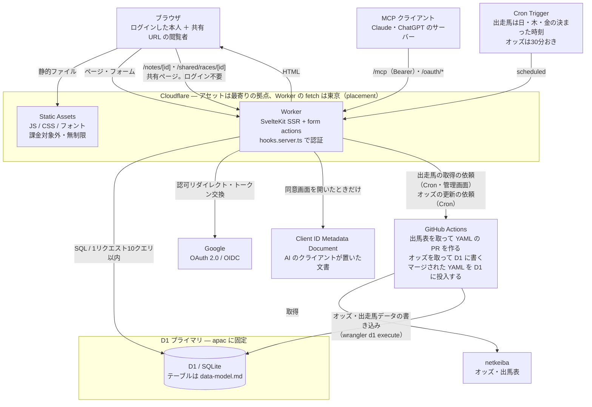

外部依存は **Google OAuth と、取得元（netkeiba）と、GitHub の API と、AI のクライアントが置いた Client ID Metadata Document の4つ**。
netkeiba へは GitHub Actions だけが行き、Worker は行かない（→ 3-8・3-9）。GitHub へは出走馬の取得とオッズの更新を Actions に頼むときだけ行く。
Client ID Metadata Document へは、ログインした本人が同意画面を開いたときと「許可する」を押したときだけ、
クライアントが `client_id` に書いた HTTPS の URL へ取りに行く（→ [mcp.md 第6章](./mcp.md)）。それ以外は Cloudflare の中で完結する。
バックエンドサーバー、コンテナ、VPC、ロードバランサ、Redis — どれも要らない。

### なぜこの形になるか

数人が週末に使う規模に対して、常時起動のサーバーは過剰。
Workers はリクエストが来たときだけ実行され、来なければ何も動かない（＝何も課金されない）。
一方で「ゼロから起動する」コールドスタートの待ち時間が実質ないため、
月に数回しか触らないアプリでも初回アクセスが遅くならない。

**このアプリの使われ方（週末に集中し、平日はほぼ無風）と課金モデルが噛み合っている。**

---

## 2. レイヤ構成

Worker の中身は6層に分ける。**依存は上から下への一方向のみ**とし、逆流させない。

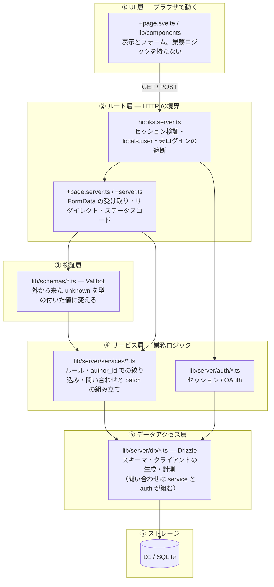

### 各層の責務

| 層 | 置き場所 | やること | **やらないこと** |
| --- | --- | --- | --- |
| ① UI | `+page.svelte`, `lib/components/` | 表示、フォームの組み立て | DB アクセス、認可判断 |
| ① UI の WebMCP 境界 | `lib/webmcp/` | tool 登録・解除、load の値の整形、下書きを既存フォームへ渡す | DB アクセス、HTTP、submit、LLM 呼び出し |
| ② ルート | `+page.server.ts`, `+server.ts`, `hooks.server.ts` | HTTP の入出力、Cookie、リダイレクト | 業務ルール、SQL |
| ② ルートの MCP | `lib/server/mcp/` | JSON-RPC の読み書き、tool の入力の検証と返す項目の選び出し、スコープの確認、応答の種類（200・400・スコープ不足）を決める | SQL、認証の判断、HTTP のヘッダ（`WWW-Authenticate` などはルートが付ける） |
| ③ 検証 | `lib/schemas/` | `FormData` / クエリ文字列を型付きの入力に変換 | DB アクセス |
| ④ サービス | `lib/server/services/`, `lib/server/auth/` | 業務ルール、`author_id` での絞り込み、問い合わせと `batch()` の組み立て | HTTP を知ること |
| ⑤ データアクセス | `lib/server/db/` | スキーマ定義、クライアントの生成（`createDb`）、クエリの計測、制約違反の見分け | 業務ルール |
| ⑥ ストレージ | D1 | 永続化、制約（FK・CHECK・UNIQUE） | — |

### 層を分ける実利 — サービス層は SvelteKit を知らない

**`lib/server/services/` は SvelteKit の型（`RequestEvent`, `Cookies`, `error()` など）を
一切 import しない。** 引数で `db` と `userId` を受け取り、値を返すだけの純粋な関数群にする。

```ts
// ✓ 良い — HTTP を知らない。テストで直接呼べる
export async function getHorseTimeline(
  db: Db, horseId: string, viewerId: string
): Promise<TimelineNote[]> { ... }

// ✗ 悪い — SvelteKit に縛られ、別の口から再利用できない
export async function getHorseTimeline(event: RequestEvent) { ... }
```

これが効いてくる場面は3つ。

1. **テスト** — Vitest から D1 のローカルインスタンスを渡して直接呼べる。HTTP のモックが要らない
2. **別の口からの再利用** — MCP の tool（`lib/server/mcp/tools.ts`）は、form action と同じ
   `savePreviewNotes`・`saveRaceReview` などのサービス関数をそのまま呼んでいる。REST API（`/api/v1/*`）はまだ無いが、
   足すときも `+server.ts` から同じ関数を呼ぶだけで済む
3. **移植性** — 万一 Cloudflare から離れることになっても、業務ロジックは素の TypeScript のまま残る

### 依存の向き — どこからどこを import してよいか

依存は**縦（層）と横（機能）の2軸**で決め、どちらも一方向にする。
今は約束で、ESLint の規則として `pnpm run lint` で止めるのは [harness.md 第2層](./harness.md) の PR から（まだ入っていない）。
ファイル単位の依存図は手で描くとすぐ実物とずれるので置かない。正はこの節と、規則を入れたあとの `eslint.config.js`。

**縦の軸 — 層**（上の図の6層を、import の単位に割ったもの）

| from ＼ to | component | ui | pure | service | auth | db | route-helper |
| --- | --- | --- | --- | --- | --- | --- | --- |
| page（`+page.svelte`・`+layout.svelte`） | ✓ | ✓ | ✓ | ✗ | ✗ | ✗ | ✗ |
| component（`lib/components/`） | ✓ | ✓ | ✓ | ✗ | ✗ | ✗ | ✗ |
| ui（`lib/components/ui/`） | ✗ | ✓ | `utils.ts` だけ | ✗ | ✗ | ✗ | ✗ |
| endpoint（`.server.ts`・`+server.ts`・`hooks.server.ts`） | ✗ | ✗ | ✓ | ✓ | ✓ | ✓ | ✓ |
| service（`lib/server/services/`） | ✗ | ✗ | ✓ | 横の軸に従う | ✗ | ✓ | ✗ |
| auth（`lib/server/auth/`） | ✗ | ✗ | ✓ | ✗ | ✓ | ✓ | ✗ |
| db（`lib/server/db/`） | ✗ | ✗ | ✓ | ✗ | ✗ | ✓ | ✗ |
| pure（`lib/schemas/`・`lib/utils/`・`lib/utils.ts`） | ✗ | ✗ | ✓ | ✗ | ✗ | ✗ | ✗ |

route-helper は `lib/server/util.ts`（`ctx` / `ctxAdmin`）。

上の表に入らないモジュールは、次のどれかと同じ扱いにする。

| モジュール | 扱い | import してよいもの | 理由・注 |
| --- | --- | --- | --- |
| monitoring（`lib/server/monitoring/`。ログと Discord への通知） | endpoint からだけ使う | pure と、db の `errors.ts` と observer の型 | **db は monitoring を import しない。** `createDb` は observer を引数で受け、ルートが `locals.monitor.onQuery` を渡す。service と auth も monitoring を知らない（失敗は投げたままにし、ルートか `handleError` が拾う） |
| mcp（`lib/server/mcp/`。MCP の JSON-RPC と tools） | endpoint と同じ。`routes/mcp/+server.ts` だけが使う | pure、service、db の型 `Db` | SvelteKit・auth・`drizzle-orm` は import しない（SQL はサービス層、誰かの判断は hooks） |
| og（`lib/server/og/`。共有の画像を PNG にする） | service と同じ。機能の軸では share | pure（描く SVG は `utils/share-card.ts` が組む）と `@resvg/resvg-wasm` | SvelteKit も D1 も知らない |
| オッズの型と検査（`lib/server/odds/odds.ts`） | pure と同じ | 何も import しない | 予想画面の読み出し（`services/odds.ts`）と、Actions が動かす `scripts/odds/` の両方から使う |
| Cron の入口（`lib/server/odds/scheduled.ts`・`lib/server/race-data/scheduled.ts`） | endpoint と同じ | endpoint と同じ | 監視の口と D1 クライアントを1回ごとに作る |
| 起動の依頼（`lib/server/odds/request.ts`・`lib/server/race-data/request.ts`・`dispatch.ts`） | service と同じ（monitoring を知らない）。機能の軸では odds・races | service と同じ | odds は races の右なので、`race-data/dispatch.ts` を使ってよい |
| Worker の入口（`src/worker.js`。SvelteKit の外） | — | adapter の成果物、`lib/server/asset-cache.ts`、Cron の入口、resvg の wasm（`@resvg/resvg-wasm/index_bg.wasm`）、トークンの口（`lib/server/auth/token-endpoint.ts` と、それに渡す `createDb`・monitoring） | adapter の Worker を包むだけ（→ 3-5・3-7・3-8・3-9・[mcp.md 第1章](./mcp.md)） |
| WebMCP（`lib/webmcp/`） | UI 側 | pure（schemas / utils）だけ | API と型の変動をこの境界に閉じ、`load` が本人に渡した材料を再利用する。新しい問い合わせ経路や保存責務は持たない（→ [mcp.md 第7章](./mcp.md)） |
| `scripts/`（Node で直接動く。Worker に束ねない） | — | `src/` の pure と `lib/server/odds/odds.ts` | `src/` のファイルは相対パスに `.ts` まで書いて読む。取得元に固有の処理は `scripts/odds/netkeiba/` の中に閉じ、`odds.ts` の型（`RaceOdds`・`OddsProvider`）より外に出さない |

- **画面側（page / component）はサーバーのコードを型ですら import しない。** 画面が要る型は
  `./$types` の `PageData` から取るか、pure に置く。SvelteKit は `$lib/server` の値の import は
  止めるが `import type` は通す
- **SQL は db と service（と auth）にしか無い。** `drizzle-orm` をルートやコンポーネントから import しない

パッケージ単位の禁止:

| 対象 | import しないもの |
| --- | --- |
| services / auth / db / schemas / utils | `@sveltejs/kit`・`$app/*` |
| routes / components / schemas / utils | `drizzle-orm` |
| auth 以外 | `arctic`・`@oslojs/*` |

**横の軸 — 機能**

機能は次の順に並べ、**右は左を使ってよいが、左は右を使わない**。順位で並べるので循環は起こりえない。

```
horses ← races ← odds ← notes ← jockeys ← graded ← share ← dashboard
  馬     レース・     オッズ  メモ・見立て・  騎手の    重賞の   共有     ダッシュボード・
         出馬表・枠           印・札・的中    まとめ・  傾向・   リンク   今週
                                             騎乗      年ごとの
                                                       メモ
```

jockeys（騎手）はマスタの表を持たず、出走馬（`race_entry.jockey`）の名前で束ねる。騎乗（races）に自分のメモ（notes）を重ねるので notes の右に置く。
graded（重賞）も同じくマスタの表を持たず、レース名を別名の表（`utils/graded-race.ts`）で寄せた鍵で束ねる。
年ごとのレース（races）に自分のメモ・印（notes）を重ねるので notes の右に置く。

- 機能を持たないもの（shared）: `lib/schemas/`・`lib/server/db/`・`lib/server/auth/`・`lib/server/monitoring/`・
  `lib/utils/` の `date` / `redirect` / `role`・`components/ui/`。どの機能からも使ってよいが、shared から機能は使わない
- services のうち `favorites`・`profile`・`mcp-usage`・`race-shares`・`entries-fetch` の機能への所属はまだ決めていない（→ [harness.md 第8章](./harness.md)）
- **ルート（`src/routes/`）は機能を組み合わせる場所**なので、横の軸の制約は受けない
- 今ある違反（直す予定）は [harness.md 2-5](./harness.md)

---

## 3. データアクセスの経路

### 3-1. D1 クライアントの生成とライフサイクル

D1 への入口は `event.platform.env.DB` というバインディング1つ。
**Worker にはグローバル状態を置かず、リクエストごとに Drizzle クライアントを作る。**

```ts
// src/lib/server/db/index.ts
import { drizzle } from 'drizzle-orm/d1';
import { instrumentD1, type QueryObserver } from './instrument';
import * as schema from './schema';

export function createDb(env: App.Platform['env'], observe: QueryObserver) {
  return drizzle(instrumentD1(env.DB, observe), { schema });
}
export type Db = ReturnType<typeof createDb>;
```

ルートは `ctx(locals, platform)`（`lib/server/util.ts`）から `db` を受け取る。中で `createDb` を呼んでいる。
`instrumentD1` は D1 の binding を包み、クエリごとの時間と失敗を `observe` に渡す
（D1 の失敗と遅いクエリの監視。→ [monitoring.md 第3章](./monitoring.md)）。

Workers の実行環境は複数リクエストで再利用されうるため、
**モジュールスコープに DB 接続やユーザー情報を保持するとリクエスト間で漏れる。**
Drizzle クライアントの生成自体はほぼコストゼロなので、毎回作って問題ない。

接続プールは存在しない。D1 はバインディング経由の RPC であり、
TCP コネクションの管理という概念がそもそもない。

### 3-2. 読み取りの経路 — `GET /horses/[id]`

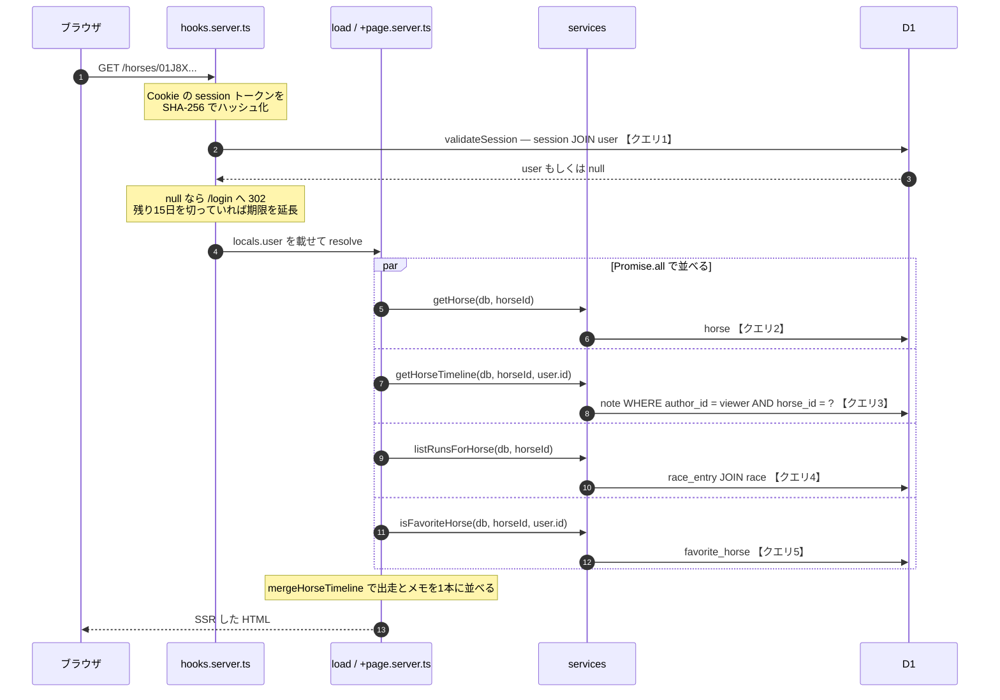

**1ページ＝セッション検証1＋読み4（並行）。** メモのタイムラインが1クエリで済むのは、
`note` に `horse_id` を非正規化しているため（→ [data-model.md](./data-model.md)）。
レース紐付きメモと近況メモをマージする処理が要らない。

使うインデックスは `note_author_horse (author_id, horse_id, occurred_at)`。
**先頭が `author_id`** なのは、読みが必ず viewer で絞られるため（→ 3-6）。
D1 は**スキャンした行数**で課金されるので、インデックスが効いているかどうかが
そのままコストに直結する。

### 3-3. 書き込みの経路 — `POST /races/[id]`（ふりかえりの一括保存）

ふりかえり画面の一括保存（`default` の action）。**このアプリで最も文の数が増える経路。**

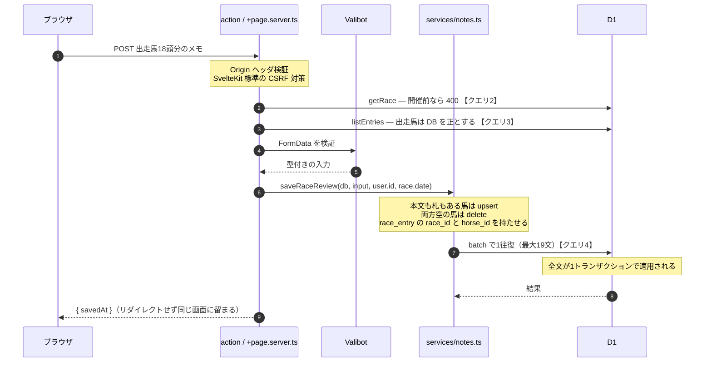

クエリ1はセッション検証。**`batch()` を使う理由は速度だけではない。**
個別に `INSERT` を19回投げると、往復19回に加えて
1リクエストのクエリ数（→ 7-1）を消費する。
`batch()` は1トランザクションとしてまとめて適用されるため、
途中で失敗したときに半分だけ保存される事故も防げる。

### 3-4. 認証の経路

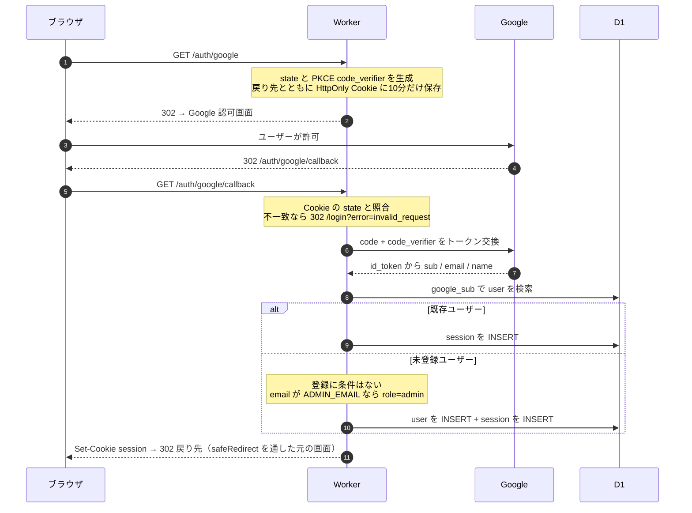

交換に失敗したときは `302 /login?error=oauth_failed`。
Google への通信は Worker からの**サブリクエスト**で、Cloudflare は課金しない
（"Cloudflare does not bill for subrequests you make from your Worker"）。

### 3-5. 静的アセットは Worker を通らない

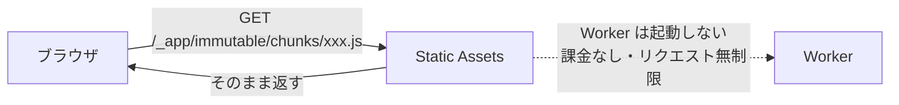

SvelteKit がビルドした JS/CSS はここに乗る。**この分は一切コストにならない。**

画像も同じ場所に置く。`src/lib/assets/` に置いて import すると、Vite が名前にハッシュを付けて
`/_app/immutable/assets/` に出すので、JS/CSS と同じく1年キャッシュされ、差し替えれば URL ごと変わる。
ただし 4KB 未満のファイルは JS に data: URI で埋め込まれ、別ファイルにならない。
キャッシュさせたい画像は `?no-inline` を付けて import する（コース図 `CourseMap` がこの形）。
R2 は、利用者が画像を上げる機能を作るときまで入れない。

見つからなかったときだけは Worker に落ちる。`/_app/immutable/*` には adapter の `_headers` で
`Cache-Control: public, immutable, max-age=31536000` が付き、これは 404 にも付く。デプロイの
切り替わりの間に新しいチャンクが 404 で返ると、ブラウザがその 404 を1年抱えて画面が JS 無しで固まる。
そこで Worker の入口 `src/worker.js` が adapter の Worker を包み、
失敗に付いた `immutable` を `no-store` に差し替える（`src/lib/server/asset-cache.ts`）。
adapter は自分の設定の main を消して書き出すので、adapter には `wrangler.adapter.toml` を読ませ、
書き出し先（`.svelte-kit/cloudflare/_worker.js`）と wrangler の main（`src/worker.js`）を分けている。

これは抱えるのを防ぐだけで、すでに 404 を抱えたブラウザには届かない（キャッシュから返るので Worker に来ない）。
その人への対応は [operations.md「利用者の画面が JS 無しで固まったら」](./operations.md)。

### 3-6. 認可はどの層でかけるか

**「誰のメモか」の絞り込みはサービス層の SQL に埋める。** UI では絞らない。

```ts
// services/notes.ts — WHERE 句に必ず viewer の条件を入れる
where(and(
  eq(note.horseId, horseId),
  eq(note.authorId, viewerId),
))
```

UI 側でフィルタすると、見えてはいけない行が
SSR の HTML やデータペイロードに乗ってしまう。
**DB から出さない**のが唯一確実な方法。

他人に見せるかを `visibility`（`private` / `unlisted`）で判定するのは**共有ページの1件引きだけ**。
ログイン中の読みはすべて `author_id = :viewer` で閉じているので、
公開範囲の判定がそもそも要らない（→ [product.md](./product.md) の「既定は非公開。共有は1メモずつ」）。

```ts
// services/notes.ts の getSharedNote — 他人に見せる判定に visibility を使うのはここだけ
where(and(eq(note.id, noteId), eq(note.visibility, 'unlisted'), isNull(user.deletedAt)))
```

**この形の弱点は「絞り忘れ＝全員に見える」になること。**
`author_id` の条件が1本抜けるだけで全ユーザーのメモが出る。
だから**サービス層の読み取り関数は `viewerId` を必須引数で受け取る**形を崩さない。
省略可能にしたり既定値を与えたりした時点で、この防波堤は消える。
推しの馬・騎手のまとめ・重賞の傾向のメモなど、本人だけのほかの表も同じ形で絞る（→ 第0章「本人のデータ」）。

一方「admin だけがマスタを編集できる」といった**操作の可否**はルート層で弾く。
データの絞り込みはサービス層、操作の可否はルート層、と役割を分ける。

### 3-7. 共有ページはこの経路の例外

共有ページは2つある。メモ1件の `/notes/[id]` と、予想まとめの `/shared/races/[id]`。
どちらも `hooks.server.ts` の `PUBLIC_PATHS` に入り、`locals.user` が null のまま load に到達する。

#### 3-7-1. 共通の約束

| | 通常のルート | 共有ページ |
| --- | --- | --- |
| `locals.user` | 必ず非 null | null でも通る |
| 該当なし・凍結済みの著者 | — | **404**（403 にすると「その ID は在る」と漏れる） |
| ヘッダ | 既定 | `X-Robots-Tag: noindex, nofollow` / `Referrer-Policy: no-referrer` / `Cache-Control: private, no-store` |
| ルートのレイアウト | `user` を返す | ログイン中も `user: null`（HTML やデータ応答にアカウント情報を含めない） |

著者の名前は `user.public_name` だけを出す。未設定は「匿名」で、Google の名前へは戻さない。

#### 3-7-2. `/notes/[id]`

WHERE は `id = :id AND visibility = 'unlisted' AND user.deleted_at IS NULL`（`getSharedNote`）。
未ログインの閲覧者はセッション Cookie を持たないので検証クエリが走らず、
**主キー1件引きの1クエリだけ**で返る。通常ページより軽い。

#### 3-7-3. `/shared/races/[id]`

本人が `/races/[id]/summary` の `?/share` を送ったときに、`viewerId` で絞った予想を `race_share.content` にコピーする。
公開ページはこのコピーと `user.public_name` だけを読み、`note` は読まない。既存のメモ閲覧の規則は変えない。
`race_share` は `(author_id, race_id)` ごとに1件。更新は同じURL、取り消しはコピーを削除し、再共有は新しいID。
load が返すのは、ほかにログインしているかの真偽（`signedIn`）だけで、未ログインの人に案内を出すのに使う。

#### 3-7-4. 共有の画像（OGP）

SNS に貼ったときのプレビューも、`race_share` のコピーと公開名だけから組む。印を描いた画像
`/shared/races/[id]/og.png` は Worker が描く。SVG を `utils/share-card.ts` で組み、`lib/server/og/render.ts` が resvg（wasm）で PNG にする。

- Workers は実行中にバイト列から wasm をコンパイルできず、SvelteKit（Vite）の側では `.wasm` を import できない。
  そこで wrangler が束ねる `src/worker.js` が import し（コンパイル済みの `WebAssembly.Module` になる）、`env.RESVG_WASM` に足して渡す。
  `vite dev` はこの入口を通らないので描けない（503）。確かめるのは E2E（`wrangler dev`）
- フォントは Noto Sans JP の太字を ASCII・Latin-1 と JIS X 0208 に絞ったもの（約 2.7MB。`pnpm run og-font` で書き出してコミット）。
  Worker の本体には束ねず、`static/og/` に置いて `ASSETS` のバインディングから読む。それ以外の字（第3水準以上の漢字・絵文字）は画像では空白になる
- wasm の初期化とフォントは isolate ごとに1度だけにし、モジュールスコープに置く（初期化は2度呼ぶと例外）。
  利用者に依らない不変のものなので、第0章の「モジュールスコープに持たせない」（接続とユーザー情報）には当たらない
- 1枚の描画は手元で初回 60〜80ms、2枚目から 20〜30ms（CPU の上限 1000ms に対して十分低い）。
  画像も共有ページと同じく `no-store`。取りに来るのは SNS のクローラーで、1回取れば向こうが持つ

### 3-8. オッズの取得 — GitHub Actions だけが外へ取りに行く

予想画面に出す単勝・複勝のオッズは、GitHub Actions（`odds-update.yml`）が取得元から取って `race_odds` に書き、
画面は D1 の値を読むだけ（なぜ例外として取り込むかは [product.md](./product.md) の「例外 — オッズ」）。**Worker は取得元へ行かない。**
Actions を30分おきに起動するのは Worker の Cron で、取りに行く時間帯に入った重賞があるときだけ `workflow_dispatch` で起動する。

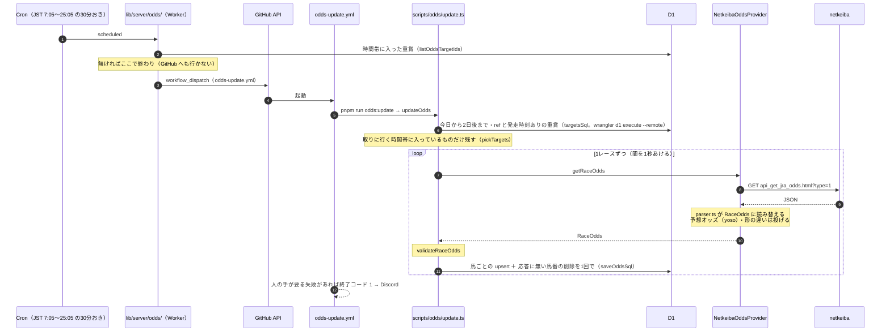

| 層 | 置き場所 | 持つもの |
| --- | --- | --- |
| 型と約束 | `src/lib/server/odds/odds.ts` | `RaceOdds`・`OddsProvider`・`OddsError`（失敗の種類）・`validateRaceOdds`。予想画面の読み出しと共有する |
| 取得元 | `scripts/odds/netkeiba/` | URL と通信（`provider.ts`）、応答の読み替え（`parser.ts`。通信しないので fixture で試す） |
| 手順 | `scripts/odds/update.ts` | 順番・再試行・ログの重さ。対象の選び方と保存は `OddsStore` として受け取る |
| 保存 | `scripts/odds/store.ts` | 対象を選ぶ SQL と保存の SQL。値を文字列に埋める（`wrangler d1 execute` はバインドを受けない） |
| 入口 | `scripts/odds-update.ts` | `wrangler d1 execute` の store・provider・ログを作って渡す。**取得元を替えるときに直すのはここだけ** |
| 起動 | `src/lib/server/odds/scheduled.ts`・`request.ts` | Worker の Cron。時間帯に入った重賞があれば `odds-update.yml` を起動する（`race-data/dispatch.ts` の `dispatchWorkflow`）。取得元へは行かない |
| 読み出し | `src/lib/server/services/odds.ts` | 予想画面の `getRaceOdds`。Worker が触るのはここだけ |

**なぜ Worker で取らないか。** netkeiba の手前の CloudFront が、Cloudflare Workers から来たリクエストを
時間帯によってまとめて 400（本文なし）で返す。Worker の拠点を変えても変わらず、同じ時間帯に GitHub Actions と手元からは 200 が返る。
Workers の外向きの IP は多くの Worker で共有されていて、その IP ごとに制限されていると見ている。IP やヘッダを変えて避けることはしない（下の約束）。

- D1 へは `data:import:remote` と同じく `CLOUDFLARE_API_TOKEN` で `wrangler d1 execute --remote` する。1回の起動で
  読むのが1回、書くのが対象のレースごとに1回

**なぜ起動を Worker の Cron にするか。** GitHub の schedule は混んでいると間引かれ、起動しない回や数時間遅れる回が多い。
Cloudflare の Cron は時刻どおりに動き、`workflow_dispatch` は間引かれない。Worker がするのは GitHub の API を1回叩くことだけで、
取得元へは行かない（上の CloudFront の制限には当たらない）。

- 対象が無い回（ほとんどの回）は Worker が D1 を1回読んで終わり、Actions は起動しない
- 起動の合図とその後の Actions で2回、同じ選び方をする（Worker は `services/odds.ts` の `listOddsTargetIds`、Actions は `store.ts`）。
  Worker だけは、発走まで1分を切ったレースを外す（Actions が D1 を読む頃には発走を過ぎ、何もせずに終わるため）。
  Actions の起動が遅れて発走を過ぎたら、Actions 側で対象から外れて何もしない
- トークンは出走馬の取得と同じ `GITHUB_DISPATCH_TOKEN`（このリポジトリの `Actions: Read and write`。→ 3-9）
- 起動から取得のステップが始まるまでは実測で20秒ほど。30分おきは目安で、画面は「何時時点」を出す
- `odds-update.yml` は main からしか動かない（`if: github.ref == 'refs/heads/main'`）。本番の D1 に書くため
- 手元では `pnpm run odds:update --local` で、ローカルの D1 に向けて1回ぶん動く（取得元へは本当に行く）

**取得元への負荷を抑える約束**（取得元に止められたら機能ごと失う）:

- 対象は YAML に `ref` と `startTime` を書いた**重賞（G1〜G3）だけ**。取りに行く時間帯は格で決まる（`src/lib/utils/odds.ts`）

  | 格 | 取りに行き始める | 1レースの回数（日曜 15:40 発走の例） |
  | --- | --- | --- |
  | G1 | 前々日の 18:30（金曜から売る G1 がある） | 金 14回 + 土 37回 + 日 18回 = 69回 |
  | G2・G3 | 前日の 18:30（前日発売のオッズが出始める頃） | 土 14回 + 日 18回 = 32回 |
  | L・OP・条件戦 | 取りに行かない | 0回 |

  どれも発走まで。Cron は JST 7:05〜25:05（翌 1:05）に回す（時刻の正は `wrangler.toml` の `crons`）。5分ずらすのは、
  発走の直前の回（15:40 発走なら 15:35）が発走に重ならないように。ネットの前日発売は夜間も売っているので 25:00 まで取り、
  25:00〜7:00 は取りに行かない。発売前は取得元が予想オッズしか返さず、何も保存しない（`not-available`）
- 1レースずつ順に取り、間を1秒あける。並列にしない
- 再試行は、届かなかった・5xx のときに1回だけ（3秒あけて）。429 か取得元の `limit` が返ったら、
  **その回の残りのレースも取りに行かずに終える**
- 制限を避けるための細工（プロキシ・IP の切り替え・User-Agent の偽装）はしない。User-Agent は用途を名乗る

**失敗しても前の値を壊さない。** 取れなかった・形が違った・値がおかしい（0以下、下限 > 上限、馬番の重複）ときは
何も書かず、前回の値が時点とともに残る。保存の2文（upsert と削除）は1回の `--command` で送る。
`--remote` のときは D1 の REST API（`/query`）に1回で渡り、API の文書は「複数の文は batch として実行する」としている
（D1 の batch は1トランザクション）ので半端に混ざらない。最後の砦として `race_odds` の CHECK もある。

### 3-9. 出走馬の取得 — Worker は Actions を起動するだけ

出馬表（候補・枠順）は、Worker が netkeiba から取って D1 に書くのでは**なく**、GitHub Actions が
`data:fetch entries` で `data/races/*.yaml` を書き、PR を作る。本番に入るのは人がマージしたとき（`data-import.yml`）。
出走馬データの正を YAML に置いたままにするため（第0章「DB とデータ」）。Worker が D1 に直接書くと、次に YAML を
投入したときに枠・馬番が YAML の値で入れ直され（そのレースぶんを NULL にしてから入れる）、書いたものが消える。

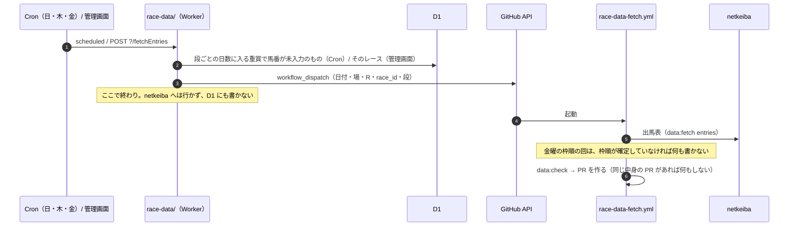

| 層 | 置き場所 | 持つもの |
| --- | --- | --- |
| 依頼 | `lib/server/race-data/dispatch.ts` | GitHub の API に1回送る。失敗の種類（`DispatchError`） |
| 手順 | `lib/server/race-data/request.ts` | Cron の対象を1つずつ頼む・止める条件・ログの重さ |
| 対象 | `lib/server/services/entries-fetch.ts` | D1 から対象のレースを選ぶ（読むだけ） |
| 入口 | `lib/server/race-data/scheduled.ts`・`/settings/admin` の `?/fetchEntries` | 監視の口と D1 クライアントを作って渡す |
| 取得 | `.github/workflows/race-data-fetch.yml` → `scripts/race-data.ts` | netkeiba への取得・YAML の書き込み・PR。Worker が頼む `data:fetch entries`（Cron・管理画面）に加え、Actions のタブから手で起動する `data:fetch result`（`command: result`。Worker は頼まない）もここ |

- Cron は JRA の発表に合わせて3段で頼む。段は Cron の式で決まる（`race-data/scheduled.ts` の `ENTRIES_CRONS`。時刻の正は `wrangler.toml` の `crons`）。
  対象はどの段も重賞（G1〜G3）で、レース番号があり、馬番がまだ1頭も無いもの（枠順の PR がマージされると外れる）

  | 段 | Cron（UTC）= JST | 発表 | 対象（今日から何日後） | 確定待ち |
  | --- | --- | --- | --- | --- |
  | `candidates`（候補） | `30 7 * * sun` = 日曜 16:30 | 日曜 16時に翌週の重賞の候補。G1 はその1週前 | G2・G3 は1〜8日後、G1 は1〜15日後 | しない |
  | `entries`（出走馬） | `30 6,8 * * thu` = 木曜 15:30・17:30 | 木曜 14時〜16時すぎ | 1〜4日後 | しない |
  | `frames`（枠順） | `30 2 * * fri` = 金曜 11:30 | 金曜 10時すぎ | 1〜3日後 | する |

- 木曜の回は発表の前でも出馬表をそのまま書く。発表前なら候補のままで、開いている PR か main と同じ中身になり何も出ない。
  発表後は出馬表に無い候補が withdrawn に移る。木曜に枠順が出るレース（G1・土曜の重賞）は、木曜の回で枠・馬番まで入る。
  表の「金曜10時すぎ」は日曜の重賞の枠順
- race_id（`external_ref`）の無いレースは、Actions が netkeiba のレース一覧から引く。一覧には、特別登録が済んだ重賞なら
  2週先の G1 でも出る。引けなければ Actions が落ちて Discord に知らせる。
  管理画面のボタンは、登録前のレースを押させないよう、race_id の無い当週より先のレースを止めたままにしている（`entriesFetchBlocker`）
- 決まった時刻に1回ずつしか頼まない。その回が落ちたら（GitHub に届かない・Actions が落ちる。どちらも Discord に知らせる）、管理画面の「出走馬を取得」で取り直す。
  金曜の回で枠順がまだ確定していなければ、Actions は何も書かずに Discord の「デプロイ」に知らせる（取り直しのきっかけ）。
  祝日で発表の曜日がずれる週も、管理画面から取り直す
- 起動元（Cron・管理画面）によらず、開いている PR と同じ中身なら何もしない（PR も通知も出ない）。
  開いている PR が無ければ（PR の作成で落ちてブランチだけ残った・人がマージせずに閉じた、も含む）、作り直して PR を作る。
  PR ができたら Discord の「デプロイ」に知らせる
- トークン（`GITHUB_DISPATCH_TOKEN`）は、このリポジトリの Actions に書き込めるだけのもの。漏れても
  できるのは main のワークフローの起動までで、出走馬の取得でできた PR は人がマージするまで本番に入らない。
  ただし同じトークンで起動する `odds-update.yml`（3-8）は、本番の D1 の `race_odds` に直接書く。
  書くのは main のコードが取得元から取って検査を通した値だけで、起動する人がその中身を決めることはできない

### 3-10. MCP と OAuth 2.1 — AI のクライアントは本人が許した範囲だけを読み書きする

Claude・ChatGPT から読める（許せば予想・展開の予想・ふりかえりを書ける）ように、同じ Worker に MCP の口（`/mcp`）と、その認可サーバー（`/.well-known/*`・`/oauth/*`）を置く。
tool はサービス層を呼ぶだけで、`viewerId` はトークンの持ち主。トークンの口だけ `src/worker.js` が SvelteKit より先に受ける。
経路・書くときの決まり・スコープ・回数の上限・リフレッシュ・クライアントの識別と、ブラウザ内の WebMCP は [mcp.md](./mcp.md)。

---

## 4. デプロイと環境

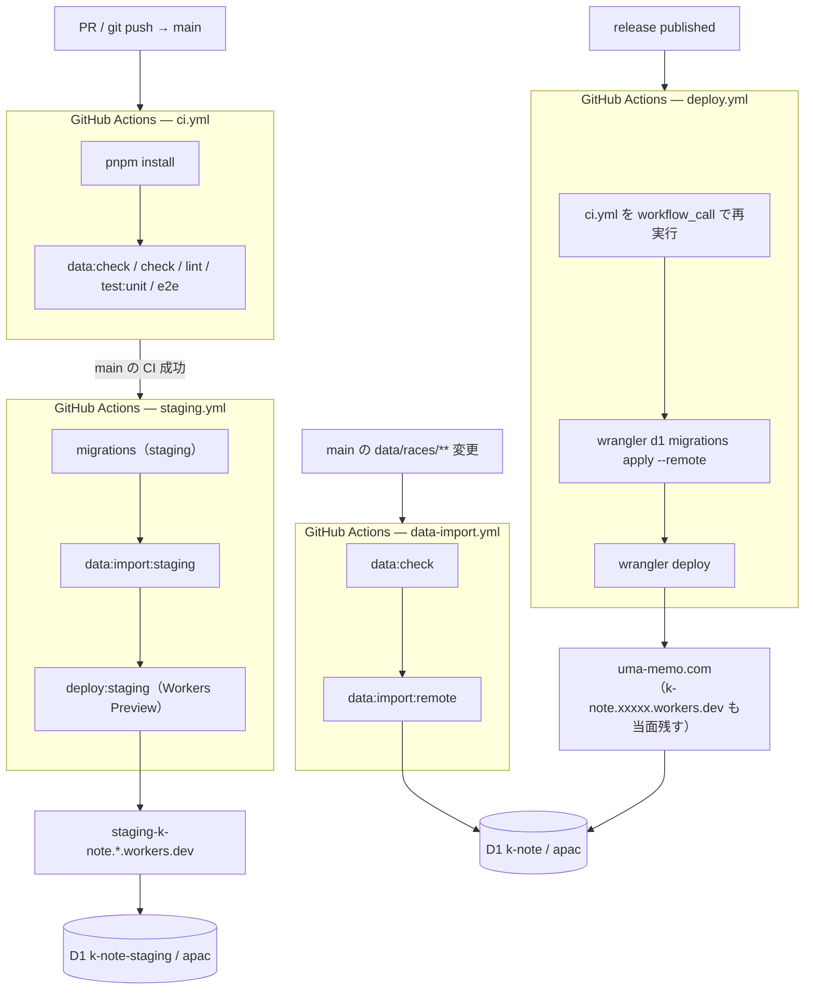

オッズ（`odds-update.yml`）と出走馬の取得（`race-data-fetch.yml`）のワークフローは 3-8・3-9。
手順・設定・ワークフローの一覧は [operations.md「デプロイ」](./operations.md)、ステージングは [staging.md](./staging.md)。

| 環境 | Worker | D1 | 反映 | 用途 |
| --- | --- | --- | --- | --- |
| local | `vite dev`（Miniflare 経由） | ローカル SQLite（`.wrangler/state`） | — | 開発 |
| staging | Workers Preview `staging`（`wrangler.toml` の `[previews.*]`） | `k-note-staging` | main の CI が成功したら `staging.yml` | リリース前の確認 |
| production | `k-note` | `k-note` | リリースの publish で `deploy.yml`、出走馬データは `data-import.yml` | 本番（`uma-memo.com`） |

Worker と D1 の名前が旧名の `k-note` のままなのは意図どおり。変えると別の Worker・別の D1 になる
（→ [operations.md「名前について」](./operations.md#名前について)）。

### アプリとデータを別系統で出す理由

アプリは `main` へのマージでは本番に出ない。出るのはリリースを publish したときだけで、
main は「次に出す候補」。どこを出すかはタグを切る側が決める。

出走馬データはリリースを待たずに `main` へのマージで入る。周期が違うためで、
出馬表は開催前に入っている必要があり、1レースにつき 予定 → 枠確定 → 結果 の3回更新される。
データ側に版番号は振っていない。**適用状況はファイル内容の SHA-256 を `data_import`
テーブルに持つ形で表していて**、投入先（local / staging / remote）ごとに別に進む。

結合点は1つだけ。YAML に新しい項目を足す変更はスクリプトとスキーマの変更を伴うので、
**先にアプリのリリースが要る**。逆は自由で、データ更新はアプリに影響しない。

**マイグレーション → デプロイの順に固定している。**
逆にすると新しいコードが古いスキーマに当たる。この順でも
「古いコードが新しいスキーマに当たる」窓が数十秒開くので、
列を消すような破壊的なマイグレーションはそれを承知で流す（利用者が数人なので許容する）。

リリースのタグは main の CI を通った commit のはずだが、任意の commit からも
タグは切れるので、`deploy.yml` は出す前に `ci.yml` をもう一度呼んで回す。

### D1 の配置

**D1 は `--location apac` で作る**（コマンドは [operations.md](./operations.md)「D1 を作る」）。
D1 は「プライマリが1箇所にある SQLite」であり、Worker 自体はユーザーの近くで動いても、SQL は毎回プライマリまで往復する。
プライマリはあとから移せない。

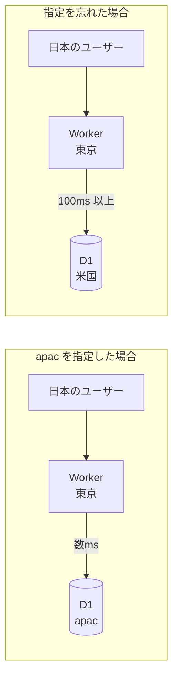

クエリのたびに 100ms 以上が乗り、そのまま体感に出る。
利用者が日本だけなので apac 固定が最適。読み取りレプリカは要らない。

---

## 5. 採用技術

### 5-1. 一覧

| 領域 | 採用 | バージョン想定 |
| --- | --- | --- |
| フレームワーク | SvelteKit（Svelte 5 runes） | 2.x / 5.x |
| アダプタ | `@sveltejs/adapter-cloudflare` | 最新 |
| ランタイム | Cloudflare Workers | `compatibility_date` は作成時の日付で固定 |
| DB | Cloudflare D1（SQLite） | — |
| ORM | Drizzle ORM + drizzle-kit | 0.4x |
| 認証 | Arctic（OAuth）+ Oslo（暗号・エンコード） | Arctic 3.x |
| 検証 | Valibot | 1.x |
| スタイル | Tailwind CSS v4 | 4.x |
| テスト | Vitest / Playwright | — |
| パッケージ管理 | pnpm | — |
| CI/CD | GitHub Actions + Wrangler | — |

### 5-2. なぜこれを選んだか

**SvelteKit** — 人が選んだ。この用途には実際よく合う。
本アプリはフォームの塊（レース登録、出走馬入力、メモ）であり、
SvelteKit の form actions は JS が無効でも動く HTML フォームがそのまま基盤になる。
クライアント側の状態管理ライブラリが要らず、バンドルも小さいまま済む。
Workers は CPU 時間で課金・制限されるため、SSR が軽いことはそのままコストに効く。

**D1** — メモをレース軸と馬軸の両方から引く、つまり関係を辿る読み方が中心。
KV（結果整合・キー参照のみ）や Durable Objects（単一エンティティの強整合）では
横断クエリが書けない。SQL が必要で、規模は小さい。D1 の適合範囲のど真ん中。

**Drizzle** — D1 ドライバが公式にあり、生成されるマイグレーションが読める SQL。
Prisma は Workers 対応こそ進んだがバンドルが重く、CPU 時間で課金される環境では不利。
生 SQL は型が付かず、`note` のような条件付きカラム（kind ごとに埋まる列が変わる）を
手で扱うと事故る。Drizzle はその中間として妥当。

**Arctic + Oslo** — Lucia はライブラリとしての提供をやめ実装ガイドに移行したため、
その構成要素である Arctic（OAuth クライアント）と Oslo（暗号・エンコード）を直接使う。
どちらも Web Crypto ベースで Node 固有 API に依存せず、Workers でそのまま動く。
セッション管理は自分で書くが、`auth/session.ts` の170行ほどで収まっている。

**Valibot** — Zod と同等の書き味でバンドルが小さい。
ここも CPU 時間と起動コストに直結するため軽い方を採る。

### 5-3. 検討して採らなかったもの

| 候補 | 不採用の理由 |
| --- | --- |
| Cloudflare Access | 誰でも登録できる仕組みなので門は要らない |
| Neon / Supabase + Hyperdrive | 本物の Postgres は魅力だが構成要素が増える。D1 で足りる規模 |
| Workers KV をメインストアに | 結果整合でクエリが書けない。メモの横断参照に致命的 |
| Durable Objects | 単一エンティティの強整合が要件ではない。オーバースペック |
| Prisma | バンドルサイズと CPU コスト |
| REST API + SPA | 画面遷移ごとに API を叩く分リクエストが増え、実装も二重になる |
| MCP の公式 SDK | `nodejs_compat` が要る（第0章）。`/mcp` はステートレスで JSON を返すだけなので自前で足りる |

### 5-4. バンドルサイズ

Worker のバンドルサイズ上限は圧縮後 10MB（Paid）。SvelteKit の SSR コードならまず当たらないが、
重い依存を足すときは意識する。共有の画像のための resvg の wasm で、圧縮後 約 1.3MB になっている
（足す前は約 370KB。フォントは Static Assets に置き、ここに入れていない。→ 3-7-4）。

---

## 6. コスト

**Cloudflare の利用料は月額 $5（Workers Paid の基本料）。含まれる枠に収まり、従量課金に届く見込みはない。**
Paid では上限を超えると止まらずに課金されるので、暴走の見張りを [monitoring.md 第9章](./monitoring.md) に置いた。

ほかにかかるお金は独自ドメイン `uma-memo.com` の年額だけ。
Workers の Custom Domains は無料で、Google OAuth も無料。

### 6-1. 含まれる枠と、このアプリの想定使用量

前提: 実利用者5人、開催日（土日）中心、1開催日あたり12レースをふりかえる。
登録は誰でもできるが、検索にも一覧にも出ないので、外から見つけて登録してくる人はいない見込み。
外れても、含まれる枠に対して桁が違う。

| 項目 | Paid に含まれる枠（月） | 本アプリの想定 |
| --- | --- | --- |
| Worker リクエスト | 1,000万 | 約 350 / 開催日 |
| 静的アセット配信 | 無制限・課金対象外 | — |
| D1 rows read | 250億 | 約 35,000 / 開催日 |
| D1 rows written | 5,000万 | 約 1,500 / 開催日 ＋ オッズ 約 2,400 / 週末 |
| D1 ストレージ | 10 GB / DB | 年間 約 20 MB |

月に8開催日としても、どの項目も枠の 0.1% に届かない。
実測で見る値と、知らせを受ける閾値は [monitoring.md 9-2](./monitoring.md)。

**試算の根拠**

- リクエスト: 5人 × 60ページ遷移 + フォーム送信50回 ≒ 350。平日はほぼゼロ
- rows read: 1リクエストあたり平均100行（セッション1 + レース詳細で entries 18・notes 20 など）
- rows written: 1レースのふりかえり＝レースメモ1 + 出走馬メモ18。
  インデックスへの書き込みも rows written に計上されるため約4倍で見て 76行。
  12レースで912行、出走馬登録などを足して 1,500行
- **D1 の使用量はアカウント単位で、ステージング D1（[staging.md](./staging.md)）とも合算される。**
  出走馬データの投入（`data:import:*`）は変わったファイルだけを流すので1回あたり数百行だが、
  全ファイルを流し直すと1回で約1万7千行（索引の更新を除く）を書く。日に何度も流すと使用量が跳ねる（→ 第0章「DB とデータ」）
- ストレージ: 年間1,200レース × (entry 14 + note 15) 行 ≒ 35,000行、インデックス込みで約20 MB
- オッズ（3-8）: G1 1つ・G2/G3 2つの週末として、(69 + 32 × 2) 回 × 18頭 ≒ 2,400行の書き込み（`race_odds` は
  主キーのほかに索引が無い）。Cron は1日37回動くが、対象の無い回は D1 を1回読むだけで Actions も起動しない

### 6-2. 将来コストが増える可能性のある拡張

| 拡張 | コスト影響 |
| --- | --- |
| 全文検索（FTS5） | D1 内で完結。インデックス分のストレージのみ |
| Web Push 通知 | Cron + fetch。追加費用なし |
| 画像アップロード（レース写真など） | R2 が必要。10 GB まで無料、以降 $0.015/GB-月 |

---

## 7. 制約とスケール限界

コストより先に効いてくるのは**技術的な上限**のほう。順に。

### 7-1. 1リクエストあたりの D1 クエリは10以内

**設計ルール: 1リクエストあたりの D1 クエリは10以内に収める。** 超えそうなら JOIN か `batch()` にまとめる。
クエリ数はそのまま時間（D1 は単一スレッドで、1本ずつプライマリまで往復する）と rows read に効く。
Workers Paid の1リクエストあたりの上限（1,000）は遠いが、約束は変えない。

いちばん多いのは予想画面で、重賞のときにセッション検証を含めてちょうど10本
（`src/routes/races/[id]/preview/+page.server.ts` の load のコメント）。ここに足すときは、まず既存の読みにまとめられないかを見る。

ふりかえり画面は18頭分のメモを扱う。ここで N+1 を書くと一気に増える。

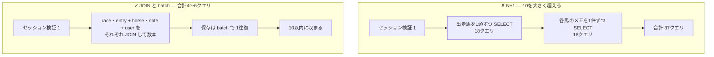

### 7-2. CPU 時間 — 上限 1,000ms / 呼び出し（`[limits] cpu_ms`）

SvelteKit の SSR は通常数ms で収まるが、18行のテーブルに Markdown レンダリングを
全行かけるような処理を足すと近づく。メモ本文の Markdown → HTML 変換は
**サーバーではなくクライアントで行う**か、軽量なパーサを使う。

超えた場合の症状は「エラーで落ちる」（利用者に 1102 が出る）であり、静かな劣化ではない。
ただし Worker ごと止められるので Discord には届かない。Workers Logs を人が見る（→ [monitoring.md 9-1](./monitoring.md)）。

### 7-3. D1 は単一スレッド

D1 は1データベースにつき1スレッドで、クエリを1つずつ処理する。
平均1ms のクエリなら毎秒1,000件が上限。5人の同時利用では問題にならない。

### 7-4. その他の上限（いずれも遠い）

| 項目 | 上限 | 備考 |
| --- | --- | --- |
| 1テーブルの列数 | 100 | 最も多い `race` でも20列ほど |
| 1行 / BLOB の最大サイズ | 2 MB | メモ本文がこれを超えることはない |
| バインドパラメータ数 | 1クエリ100個 | 18頭の一括 INSERT は `batch()` で分割されるので該当しない |
| SQL 文の長さ | 100 KB | — |

読みは load の中で `Promise.all` で並べる（予想画面で最大7本）。並べても D1 の中では1本ずつ処理される（7-3）。
