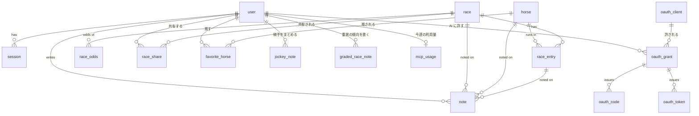

# uma-memo のデータモデル

どんな表があり、誰のもので、なぜその形なのか。メモを1つの表に統一した理由、列の埋まり方の約束、索引と CHECK の理由を書く。

作成日: 2026-10-12 / 最終更新日: 2026-10-12

- **読む場面:** 表や列を足す・変えるとき。メモの種類（`kind`）や札・展開の持ち方を触るとき。「なぜこの列があるのか」を確かめるとき
- **ここに無いもの:** 列の定義そのもの（型・NULL・既定値・外部キー）は `src/lib/server/db/schema.ts` が正で、ここには写さない。
  メモを読む関数の認可の規則は [architecture.md 第0章](./architecture.md)、画面に何を出すかは [pages.md](./pages.md)、
  何を作るか・なぜ既定を非公開にしたかは [product.md](./product.md)、出走馬データ（YAML）の書式は [data/README.md](../data/README.md)、
  OAuth の表の寿命と上限は [mcp.md](./mcp.md)

---

## 1. 全体像



`data_import` はどの表とも結ばれない（投入スクリプトだけが使う）。

**誰のものか** で表は3つに分かれる。

| 区分 | 表 | 読み書き |
| --- | --- | --- |
| マスタ（全員共通） | `horse`・`race`・`race_entry`・`race_odds` | 読むのは誰でも。書くのは投入スクリプト（YAML の PR）と admin だけ（→ [product.md 第3章](./product.md)）。`race_odds` だけは GitHub Actions が書く |
| 本人だけのもの | `note`・`favorite_horse`・`jockey_note`・`graded_race_note`・`mcp_usage`・`oauth_grant` ほか OAuth の表 | 読む関数は `viewerId`（または `userId`）を必須で受け、WHERE に本人の条件を入れる（→ [architecture.md 第0章](./architecture.md)）。他人にも admin にも共有ページにも出さない |
| 本人が公開したコピー | `race_share` | 本人が明示して作る。公開側は `note` を読まず、このコピーと公開名だけを読む |

騎手と重賞は表を持たない（次の「2. 表」の `jockey_note`・`graded_race_note` を参照）。

ID は ULID。時系列に並べられ、乱数部が80ビットあるので共有 URL にそのまま使える。日時は unixepoch の整数で、
`occurred_at` と `race.date` だけは JST の `YYYY-MM-DD` 文字列（決めた理由は [product.md 第4章](./product.md) #7）。

---

## 2. 表ごと

### user

Google アカウント1つ。`google_sub` がログイン時の引き当てキー（email は変わりうるので使わない）。
`public_name` は共有ページに出す名前で、`display_name`（Google 由来）は共有に使わない。
`role` は `admin` と `user` の2値。`deleted_at` が立っていればログインできない（退会は論理削除。理由は [product.md 第4章](./product.md) #8）。

### session

ログイン中の端末1台。`id` は**セッショントークンの SHA-256（hex）**で、生のトークンは保存しない（D1 が漏れてもなりすませない）。
索引は `user_id`（全端末からログアウト）と `expires_at`（期限切れの一括削除）。流れは [architecture.md 3-4](./architecture.md)。

### horse

馬1頭（マスタ）。

- `birth_year` は**同名馬の引き当てキー**（`UNIQUE(name, birth_year)`）なので、`birth_date` が分かっても残し、その年と一致させる。
  `birth_date` は表示用で、馬齢は生年から数える
- `birth_year` が NULL の行は、`UNIQUE(name, birth_year)` では一意にならない（SQLite は NULL どうしを別物と扱う）。
  出走予定の段階では生年が分からないまま馬を作るので、`UNIQUE(name) WHERE birth_year IS NULL` を別に持つ
- `external_ref` は netkeiba の馬 ID（YAML の `ref`）。**引き当ての第一キー**で、`UNIQUE(external_ref) WHERE external_ref IS NOT NULL`
- `training_center` は所属（`美浦`・`栗東`・`地方`・`海外`）。調教師と同じく馬の属性で、転厩で変わる
- `profile_memo` はプロフィール欄の常設メモ。タイムライン（`note`）とは別

### race

レース1つ（マスタ）。

- `course` は JRA の10場だけ。地方・海外は扱わない（今週の重賞を確実に引くため）
- `(date, course, race_number)` が一意（`race_ident`）。`race_name` の索引は、重賞の画面が `name IN (鍵と別名)` で引くとき全件スキャンを避ける
- `field_size`（出走頭数）・`winner_name`・`runner_up_name` は**取得元の値で、`race_entry` からは引けない**。
  過去走は気にしている馬しか入っていないので、行数で数えると頭数が実際より少なくなる
- `laps` は区間タイム（秒）の JSON。スタートから 200m ごとで、200m で割り切れない距離は最初の区間が端数（100m）。読み方は `utils/laps.ts`
- `start_time`（発走時刻 `HH:MM` JST）と `external_ref`（`nk-` + netkeiba の race_id）は、オッズを取りに行く重賞を決める。
  `field_size` などと同じく **YAML からだけ入る**。`/races/new` の画面には置かない（打ち間違えると別のレースのオッズが付くため）

### race_entry

出走馬1頭（マスタ）。`(race_id, horse_id)` と `(race_id, horse_number)` が一意。`race` を消すと CASCADE で消える。

- `finish_position` が NULL なら未確定・除外
- `time_diff` は勝ち馬とのタイム差（秒）。勝ち馬は2着との差を**負**で持つ（`-0.2`）。`margin`（競馬の着差の表記 `クビ`）とは別
- `odds`・`popularity` は YAML で入る**確定**の値。予想画面のオッズは `race_odds`
- `entry_jockey` の索引は騎手の画面と一覧のため。騎手は表を持たず、この列の名前で束ねる

### race_odds

最新の単勝・複勝。1レース・1馬番につき1行で、履歴は持たない（`PRIMARY KEY (race_id, horse_number)`）。
GitHub Actions が取得元から書く唯一の表で、メモからも馬柱からも参照しない（なぜ例外か → [product.md 第1章](./product.md)）。

- `as_of` はオッズの時点、`fetched_at` は取りに行った時刻。画面の「14:30時点」は `as_of`
- 取れた回は馬ごとに upsert し、応答に無い馬番は消す。取れなかった回は何も書かず、前回の値が時点とともに残る
- CHECK は馬番 1〜18、オッズは NULL か正、複勝は下限 ≤ 上限。値の検査は保存の前にもしていて、これは最後の砦

### data_import

`data/races/*.yaml` の適用状況（ファイル名・内容の SHA-256・適用時刻）。投入スクリプト専用で、アプリは読まない。
**置き場所を D1 にしているのが要点。** 適用状況は投入先ごと（ローカル D1 と本番 D1）に違うので、リポジトリ内のファイルでは片方しか表せない。
状態をデータと同じ場所に置けばずれない。

### note

メモ。本アプリの中心。下の「3. メモ」で詳しく書く。

### race_share

本人が共有した予想まとめのコピー。`(author_id, race_id)` ごとに1行で、`content` に予想の見立てと各馬のメモ・札・印を JSON でコピーする。
**公開側は `note` を読まない**ので、元のメモの `visibility` は変えず、あとからの編集・削除は「共有内容を更新」するまで公開されない。
更新は同じ ID、取り消しは行の削除で、再共有は新しい ID。凍結された著者のコピーは出さない。経路は [architecture.md 3-7](./architecture.md)。

### favorite_horse

推しの馬。`PRIMARY KEY (user_id, horse_id)` で、**行があれば推し**、消せば外れる。馬（マスタ）には何も書かない。

### jockey_note

騎手のまとめ。`PRIMARY KEY (user_id, jockey)` で、**1人・1騎手につき1本**。書き直すと上書きし、本文も札も空で保存すると行ごと消す。

- **騎手はマスタの表を持たない。** `race_entry.jockey` の名前がそのまま鍵になる。表を作ると、投入で騎手の行も作る・表記の揺れを寄せる仕事が増えるわりに、
  画面で要るのは「その名前で乗った出走」だけだから。取得元の表記が揺れる（`レーン` と `D.レーン`）と別の騎手に見える
- `note` に kind を足さず別の表にしたのは、`note` の列（`race_id`・`horse_id`・`race_entry_id`）のどれにも当たらず、`note_kind_shape` の CHECK を作り直すことになるため
  （本番の中心の表を組み直すのは割に合わない）
- 札は固定の選択肢で、ユーザーは増やせない。正は `src/lib/schemas/jockey.ts` の `JOCKEY_TAG_GROUPS`（得意な場・得意な条件・乗り方・狙いどころの4系統）。
  自由に書けると「中山巧者」と「中山◎」のように同じ意味が別の札に割れ、札で絞っても拾いきれない

### graded_race_note

重賞の傾向のメモ。`PRIMARY KEY (user_id, race_key)` で、**1人・1重賞につき1本**（本文だけで札は無い）。本文が空で保存すると行ごと消す。

- **重賞はマスタの表を持たない。** `race_key` は、レース名（`race.name`）を `gradedRaceKey`（`src/lib/utils/graded-race.ts`）の別名の表で寄せた名前。
  年をまたいだ重賞の鍵がデータに無く、レース名は年で揺れる（今年の枠は JRA の表記 `オールカマー`、過去走は netkeiba の表記 `産経賞オールカマー`）。
  YAML に鍵を足すと数百ファイルを直して本番に流すことになるので、コードの別名の表で寄せる。名前が変わった重賞は表に1行足す（足さないと別の重賞に割れる）

### oauth_client / oauth_grant / oauth_code / oauth_token / mcp_usage

AI のクライアント（Claude・ChatGPT）に、本人が許した範囲だけを読ませる（許せば予想・展開の予想・ふりかえりを書かせる）ための表。寿命・上限・掃除は [mcp.md](./mcp.md)。

| 表 | 1行 | 誰のものか |
| --- | --- | --- |
| `oauth_client` | クライアント1つ。動的登録か Client ID Metadata Document（`source`）から来る。**何の権限も持たない**（誰でも登録できるため） | 本人のものではない |
| `oauth_grant` | 本人×クライアントの連携（許したスコープ）。`UNIQUE(user_id, client_id)` | 本人。解除・凍結・user の削除で消える |
| `oauth_code` | 認可コード（SHA-256・1回きり） | grant に従属（CASCADE） |
| `oauth_token` | アクセスとリフレッシュ。SHA-256 だけを持つ。`parent_id` は出したリフレッシュトークンを辿り、回線断での送り直しを判断する | grant に従属（CASCADE） |
| `mcp_usage` | ユーザーごとの今週の tool の呼び出し回数（`reads`・`writes`）。**1人1行**で、週が変わったら上書き | 本人。管理者が行を消すと 0 に戻る |

`connected_at`（`oauth_client`）が NULL のクライアントは、一度も連携していない登録で、数の上限と期限の対象になる。一度でも連携したものは消さない。

---

## 3. メモ — `note`

### 3-1. なぜ1つの表か

要件を素直に表へ落とすと「レースのメモ」と「馬のメモ」が別物になり、**馬ごとのタイムラインを作るときに両方をマージする羽目になる。**
そこで、メモの実体を1つの `note` 表に統一し、「どのレースの」「どの馬の」メモかを**非正規化して持つ**。

```
レース観戦メモを書く
  → note (kind='entry', race_id=R, horse_id=H, race_entry_id=E)
        ↓                                ↓
  レース詳細で「このレースのメモ」    馬詳細で「この馬のタイムライン」
  として race_id で引ける              として horse_id で引ける
```

1回の書き込みが、レース側からも馬側からも自然に読める。タイムラインは `WHERE horse_id = ? ORDER BY occurred_at DESC` の1クエリで済み、JOIN もマージもいらない。
これが本アプリのデータモデルの肝。

`entry` のとき `race_id`・`horse_id` は `race_entry` から導出できるが、**あえて持つ**。主要クエリがすべて単一表の索引スキャンで済む。
整合性はサービス層（`race_entry` から値をコピーして INSERT する）で担保する。

### 3-2. `kind` ごとの埋め方

CHECK 制約（`note_kind_shape`）で強制する。

| kind | race_id | horse_id | race_entry_id | 意味 |
| --- | --- | --- | --- | --- |
| `race_preview` | ○ | NULL | NULL | **開催前**のレースの見立て（馬場の想定、狙いどころ、展開の予想） |
| `race` | ○ | NULL | NULL | **開催後**のレース自体のメモ（ペース、馬場、展開） |
| `horse` | NULL | ○ | NULL | レースに紐づかない馬のメモ（調教、近況、印象） |
| `preview` | ○ | ○ | ○ | **開催前**にこの馬をどう見ていたか（印はここだけ） |
| `entry` | ○ | ○ | ○ | **開催後**にこのレースでこの馬がどう走ったか |

**開催前と開催後は必ず別の行にする。** 列の埋まり方は同じなので1行にまとめたくなるが、まとめると走ったあとに書いた瞬間「走る前に何を考えていたか」が上書きで消える。
事前の見立てと事後の結果を見比べられることがふりかえりを書く理由なので、1行にすると機能そのものが成立しなくなる。
`race_preview`／`race` と `preview`／`entry` の2組は、どちらも同じ理由で分かれている。

そのほかの CHECK は2つある。`note_tags_json`（`tags` が JSON として壊れていないこと。中身が選択肢のどれかであることはサービス層の valibot が保証する）と、
`note_mark_kind`（`mark` は `preview` にだけ付く）。

### 3-3. 主な列

- `mark`: 予想印（`◎ ○ ▲ △ ☆ ×`）。`preview` にだけ付く。**本文が空でも印だけで残せる**
- `body`: Markdown
- `visibility`: `private`（既定。本人だけ）／`unlisted`（リンクを知っている人だけ）。**この列を見てよいのは共有ページ `/notes/[id]` だけ**（→ 3-5）
- `occurred_at`: タイムライン用。レース紐付きならレース日、それ以外は記入日（`YYYY-MM-DD`）

### 3-4. 札（`tags`）

メモに付ける札は固定の選択肢から複数選ぶ。数字（★の数）で持つと、あとで読んだときに「なぜその数字なのか」が残らない。次走の判断に使いたいのは数字ではなく理由の方なので、観点に名前を付けた。

| 系統 | 札 |
| --- | --- |
| 結論 | `次走買い` `次走消し` |
| 負けた／勝った理由 | `不利` `馬場向かず` `馬場一致` `ペース合わず` |
| レースの質 | `ハイレベル戦` `好ラップ` `好上がり` |

- **選択肢は固定で、ユーザーは増やせない。** 正は `src/lib/schemas/note.ts` の `NOTE_TAGS`
- 保存する値は `好上がり`、画面では「好上り」と出す。ふりかえり画面の「上り1位」と表記をそろえるため。保存値を変えると本番のメモの `tags` を書き換えることになるので変えない（表示の文字は `noteTagLabel`）
- 複数付けられる（「不利」＋「次走買い」が普通の使い方）。並びは `NOTE_TAGS` の順に正規化して保存する。チェックした順で持つと、中身が同じでも保存のたびに JSON が変わって差分に見える
- **本文が空でも札だけで残せる**（印と同じ扱い）
- **別表に正規化していない。** 読むのはいつも「このメモに何が付いているか」で、`note` を引けば一緒に来る形が要る。札で横断検索する画面がまだ無いうちは JSON の配列で足りる。検索したくなったらそのとき正規化する

### 3-5. 展開の予想（`flow`）

見立て（`race_preview`）に、**ペース**（スロー・ミドル・ハイ）と、**スタート・4コーナー・ゴール前**の3局面の隊列を付ける。
隊列は盤面（前後10列 × 内外4段のマス目）のどこにどの馬がいるかで、局面ごとに一言メモも付く。

```json
{ "pace": "スロー",
  "start":   { "spots": [{ "entryId": "…", "x": 0, "y": 0 }], "memo": "⑤が押してハナ" },
  "corner4": { "spots": [], "memo": "" },
  "finish":  { "spots": [], "memo": "" } }
```

- `x` は前後（0 が先頭）、`y` は内外（0 が内ラチ沿い）。1頭は1か所、1マスには1頭
- **馬は馬番ではなく出走馬の id で持つ。** 予想は枠順の前に書くことが多く、そのときは馬番が無い。枠順が入れば置いた馬に馬番が付いて見える。取り下げで出走馬から消えた馬は、読むときに落ちる
- **本文が空でも展開だけで行を残す**（印・札と同じ扱い）。本文も展開も空なら行を消す
- **展開の欄が無い保存は、展開に触らない。** 展開の欄は出走馬がいるときしか出ないので、出走馬が0頭になったレースで見立ての本文だけ直しても、保存済みのペースとメモは残す
- 形の正は `src/lib/schemas/race-flow.ts`。**「`race_preview` にだけ付く」は CHECK にしていない。** 表の CHECK を足すには `note` を作り直すことになり、1列のために本番の中心の表を組み直すのは割に合わない。書くのはサービス層の見立ての経路（`raceNoteStatement`）だけ
- 文字の隊列記法（`⑤-③⑦-⑪`）で持たないのは、書いたあとに「どこに何を置いたか」を絵で見たいため。記法は盤面から組み立てて、畳んだ1行と読み上げに使う

### 3-6. 索引と一意制約

**索引は `author_id` で始める。** ログイン中の読みはすべて `WHERE author_id = :viewer` で絞られる（→ [product.md 第2章](./product.md)）。
先頭が `race_id`・`horse_id` のままだと、自分のメモを読むだけで他人の行までスキャンする。D1 は**スキャンした行数**で課金されるので、可視性の話であると同時にコストの話でもある。

- `note_author_horse (author_id, horse_id, occurred_at)` — 馬のタイムライン
- `note_author_race_id (author_id, race_id)` — レース詳細・ふりかえり・予想
- `note_author (author_id, created_at)` — 最近のメモ・共有中のメモ一覧
- 共有ページは主キーの1件引きなので追加の索引は要らない

並びは索引でなく `ORDER BY` で指定する（実際の DDL に `DESC` は付けていない）。

編集＝上書きのための一意制約が3本ある。名前が似ているが別物。

- `note_author_entry_kind (author_id, race_entry_id, kind) WHERE race_entry_id IS NOT NULL`
- `note_author_race (author_id, race_id) WHERE kind = 'race'`
- `note_author_race_preview (author_id, race_id) WHERE kind = 'race_preview'`

**レースのメモは kind ごとに別の部分ユニークで持つ。** 1本にまとめて `(author_id, race_id)` だけで一意にすると、見立てとふりかえりが同じ行に落ちる。
出走馬側の `note_author_entry_kind` が `kind` を含んでいるのと同じ理由で、こちらは**索引そのものを分けている**
（`kind` を索引の列に足すと、1人が同じレースに `horse` 以外の種別を何行でも作れてしまう）。

---

## 4. 主要クエリ

```sql
-- 馬のタイムライン（レース観戦メモも近況メモも混ざって時系列で出る）
SELECT * FROM note
WHERE author_id = ?1 AND horse_id = ?2
ORDER BY occurred_at DESC, created_at DESC;

-- レース詳細で出す全メモ（レース自体のメモ + 各馬のメモ）
SELECT * FROM note
WHERE author_id = ?1 AND race_id = ?2;

-- ダッシュボード: 最近のメモ（他人のメモは出ない）
SELECT * FROM note
WHERE author_id = ?1
ORDER BY created_at DESC LIMIT 20;

-- 共有中のメモ一覧（/settings/shares）
SELECT * FROM note
WHERE author_id = ?1 AND visibility = 'unlisted'
ORDER BY updated_at DESC;

-- 共有ページ /notes/[id]。未ログインで `note` を読む唯一の口
SELECT * FROM note
WHERE id = ?1 AND visibility = 'unlisted';
```

**`visibility` が出てくるのは下の2本だけ。** 上の3本は viewer 自身の行しか触らないので、公開範囲の判定そのものが存在しない。
「他人の行を出さない」ことをクエリごとに間違えずに書き続ける必要がなくなったのが、既定を非公開にした設計のいちばんの効果。
予想まとめの共有ページ（`/shared/races/[id]`）は `note` ではなく `race_share` の主キー1件引き。
