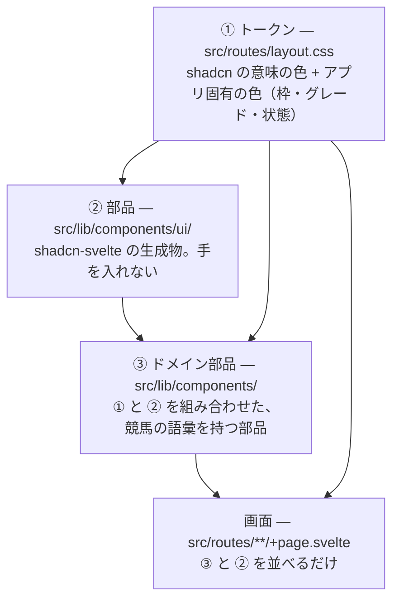

# uma-memo のデザインシステム

画面の見せ方の決まり。shadcn-svelte を前提に、色・部品・ドメイン部品をどう選ぶか。

- **読む場面:** 画面やコンポーネントの見た目を足す・変えるとき
- **ここに無いもの:** Svelte の書き方・ファイルの役割は [frontend.md](./frontend.md)、
  UX の原則（何を優先して見せるか）は [harness.md 1-3（草案）](./harness.md)、
  この決まりを lint でどう止めるか・移行の順番は [harness.md 第3層](./harness.md)、
  見た目の確かめ方は [testing.md 第5章](./testing.md)
- 作成日: 2026-09-23 / 最終更新日: 2026-10-14
- ステータス: **移行中。** 第2章の「これから足すトークン」はまだ `layout.css` に無い。
  足されるまでは使えない（未定義のクラスは何も描かないので、書いても見た目が消えるだけ）

---

## 1. 3段の組み立て

**下の段にあるもので済むなら、上の段を作らない。**

## 2. ① トークン

**色は意味で呼ぶ。** 画面とドメイン部品では、パレットの色名（`gray-500`・`red-600`）を新しく書かない。
今のコードにも残っていて、画面ごとの PR で置き換えていく（→ [harness.md 第3層](./harness.md)）。

### 2-1. 今使えるもの — shadcn のトークン

`layout.css` に shadcn-svelte の base color `neutral` で入っている。`--primary` と `--ring` だけは
テーマカラーの紺に替えてある（→ 2-4）。

| 用途 | 使うもの | 置き換える前の書き方の例 |
| --- | --- | --- |
| 本文 | `text-foreground` | `text-gray-900` |
| 補足の文字 | `text-muted-foreground` | `text-gray-500` / `text-gray-600` |
| 罫線 | `border-border`（`*` に既定で当たっているので、多くは `border` だけでよい） | `border-gray-200` / `border-gray-300` |
| 薄い面 | `bg-muted` / `bg-secondary` | `bg-gray-50` / `bg-gray-100` |
| 取り消せない操作・エラー | `destructive`（`Button variant="destructive"`、`text-destructive`） | `bg-red-600` / `text-red-700` |
| カード・浮く面 | `bg-card` / `bg-popover` | `bg-white` |
| 主な操作（保存・追加）・リンクの色 | `bg-primary text-primary-foreground`（紺。`Button` の既定もこれ） | `bg-gray-900 text-white` |
| フォーカスの輪 | `ring-ring` | — |
| 角丸 | `rounded-sm` 〜 `rounded-xl`（`--radius` から算出） | — |
| placeholder | `--placeholder`（`layout.css` の `::placeholder` が全部の input / textarea に当てる。クラスは付けない） | `placeholder:text-muted-foreground` |

`--placeholder` は shadcn に無いアプリ固有のトークンだが、2-2 と違って**もう足してあり使える**。
クラスでは使わず `::placeholder` だけが読むので、`@theme inline` には足していない。
`@layer` の外に置いてあるので、shadcn の `placeholder:text-muted-foreground` より優先される。
例文が入力済みに見えないよう、`text-muted-foreground`（`oklch(0.556 0 0)`、白地で約4.7:1）より薄い
`oklch(0.65 0 0)`（白地で約3.2:1）にしてある。文字の目安の 4.5:1 には届かないので、
placeholder には例文やヒントだけを書き、入力の意味は必ずラベルか aria-label で伝える。3:1 より薄くはしない。

### 2-2. これから足すもの — アプリ固有のトークン

shadcn に無いので、`layout.css` の `:root` と `@theme inline` に shadcn と同じ書式で足す。
**足す PR が入るまでは使えない。** それまでは、同じ用途の既存の画面と同じクラスを使う。

| トークン | 用途 | 今の書き方 |
| --- | --- | --- |
| `--warning` / `--warning-foreground` | 注意（書きかけあり、未確定） | `bg-amber-100 text-amber-900` |
| `--success` / `--success-foreground` | 済み・的中 | `bg-emerald-*` |
| `--info` / `--info-foreground` | 案内・共有中 | `bg-sky-100 text-sky-900` |
| `--bracket-1` 〜 `--bracket-8`（と `-foreground`） | 枠色。**JRA の帽子の色そのまま**（1白 2黒 3赤 4青 5黄 6緑 7橙 8桃） | `BracketBadge` の中の表 |
| `--grade-g1` / `--grade-g2` / `--grade-g3` | グレード | `GradeBadge` の中の表 |
| `--text-2xs` | 11px の小さい文字 | `text-[11px]` |

枠色とグレードは「見やすさで選んだ色」ではなく**外の世界で決まっている色**なので、
トークンにして1箇所に閉じ込める。見やすさで置き換えると、中継や新聞を見ながら読む人の頭の中と食い違う。

ただし、外の世界で決まっているのは**色味（青・赤・緑）**まで。白抜きの文字を載せる札は、
色味を保ったまま、白い文字とのコントラストが **4.5:1**（WCAG AA、11px の小さい文字）に届く明るさを選ぶ。
グレードは G1 `blue-600`・G2 `red-600`・G3 `green-700`（G3 は `green-600` だと 3.22:1 で届かないため1段暗い。値は `GradeBadge.svelte` が正）。
`--grade-g1`〜`g3` を足すときも、この値を引き継ぐ。
**6枠の札（`BracketBadge`）はまだ `green-600` に白い文字で、届いていない。**

### 2-3. ダークモード

今は作らない（`.dark` を付ける場所が無い）。トークン経由にしておけば、あとで `.dark` の値を埋めるだけで済む。

### 2-4. テーマカラーと、環境の見分け

**テーマカラーは紺**（`oklch(0.346 0.074 256)`、ファビコンの蹄鉄と同じ色）。入れるのは `--primary` と
`--ring` だけで、背景・罫線・文字は無彩色のまま。

赤・青・緑・黄・橙はグレード・枠色・状態の色（2-2）で意味が決まっている。紺は G1 の青（`blue-600`、
`oklch(0.546 0.215 263)`）や4枠の青と同じ系統なので、**明るさと鮮やかさを大きく落として**見分けられるようにしている。
テーマカラーを明るく・鮮やかにすると、「押せるもの」と「G1」「4枠」の見分けがつかなくなる。
値を変えるときは、G1 の青と並べて見分けがつくことを確かめる。

**「次走消し」の札（`slate-700`）とは明るさがほぼ同じ**で、色味の差だけで分かれている。
札は小さな文字の面、ボタンは幅いっぱいの面と形が違うので今は並べているが、
どちらかの色を変えるときはこの2つを並べて確かめる（画面カタログの `race-preview-editing-drop`）。
予想印の `×`（消し）は薄いグレーの面（`bg-muted`）に、字を `text-foreground`、輪郭を
`border-muted-foreground` で出す。表示と選択中の印で色をそろえ、記号でも意味を伝える。

**ステージングでもテーマカラーは変えない。** ステージングはリリース前に本番と同じ見た目で確かめる場所なので、
違うのは次の2つだけにする（`AppEnvMark`。`APP_ENV` が `staging` のときに出る）。

- タブのアイコンが暗い地に灰色の蹄鉄になる（`src/lib/assets/favicon-staging.svg`）。色だけでなく明るさも本番と逆にして、色覚によらず見分けられるようにしている
- ページの一番上に「ステージング環境（データは本番と別）」の細い帯が出る

ローカル（`pnpm run dev`・E2E・キャプチャ）は本番と同じ見た目にする。PR に貼るキャプチャが本番の見た目であるために。

## 3. ② 部品 — shadcn-svelte

- 部品は `pnpm exec shadcn-svelte add <名前>` で入れる。バージョンは devDependencies の
  `shadcn-svelte` に揃える（`pnpm dlx` で最新を引くと、既存の部品と書き方がずれる）。
  設定は `components.json`（style `nova`・アイコン `lucide`）
- **`src/lib/components/ui/` は手で直さない。** 見た目を変えたいときは、トークンを変えるか、
  呼ぶ側で `class` を足すか、③ のドメイン部品で包む
- 今あるもの: avatar / badge / button / card / dropdown-menu / input / label / popover / progress / select / separator / sonner / textarea / tooltip（tooltip は今は使っていない）
- **素の `<button>` `<select>` `<textarea>` を新しく書かない。** 押せる大きさやフォーカスの見え方が
  部品ごとに揃わなくなる。shadcn に無い操作が要るときは、まず `shadcn-svelte add` で足せるものが無いかを見る
- アイコンは `@lucide/svelte/icons/<名前>` を1つずつ import する

どの部品を使うかの目安:

| やりたいこと | 使う部品 |
| --- | --- |
| 押して何かが起きる | `Button`（主操作は既定、その他は `variant="outline"` / `"ghost"`、消すものは `"destructive"`） |
| 状態や分類を小さく出す | `Badge`、または ③ のドメイン部品 |
| ひとかたまりの情報 | `Card` |
| 毎回は使わない操作を畳む | `DropdownMenu`（`⋯`）。出しっぱなしにするのは毎回踏む導線だけ |
| 入力 | `Input` / `Textarea` / `Select` + `Label` |
| リンクに、読むだけの補足を浮かべる（hover・フォーカス） | `Tooltip`。今は使っていない（hover の無い端末で読めないため、`JockeyLink` は `Popover` にした）。使うなら操作（ボタン・リンク）を中に入れない |
| 見出しに付ける補足の説明 | `InfoTip`（第4章）。見出しの下の小さな字で常に出さない（理由と、注意書きは畳まないことは第6章） |
| 押して（クリック・タップして）開く小さな枠。読むものと、リンクなど少しの操作を入れる | `Popover`。trigger はボタンになる（`aria-haspopup="dialog"`）。外を押す・Esc で閉じる。マウスでもタッチでも同じ（`JockeyLink`。hover でも開くのは `InfoTip` だけ）。長く読ませるものも、hover だと途中で消えるのでこちら。ui の既定は暗い面なので、白い面にしたいときは呼ぶ側で `class` を渡す |
| 操作が済んだことを一時的に知らせる（保存しました） | トースト（`toast.success`。`Toaster` はルートレイアウトに1つだけ、下の中央、`theme="light"` 固定、`richColors` なし＝成功の緑の文字が 4.5:1 に届かない）。失敗は画面に残す |

## 4. ③ ドメイン部品

`src/lib/components/` に置く、競馬の語彙を持つ部品。

| 部品 | 何を出すか |
| --- | --- |
| `GradeBadge` | グレード（G1 / G2 / G3 / L / OP）。一覧の行ではレース名の前に置く（→ [pages.md](./pages.md)） |
| `GradedRaceTrend` | 重賞ごとの傾向のメモを、予想画面とふりかえり画面のレース情報タブに読むだけで出す枠。「このレースのメモではない」と見出しで示し、重賞の画面へ直しに行くリンクを持つ |
| `RacePlace` | 一覧の行の「中山11R」。「中山12R」が収まる幅を最小にして、1R と 11R で後ろの格の札の位置がずれないようにする。ダッシュボード・今週の重賞・レース一覧・管理画面の行で使う |
| `BracketBadge` | 枠番。色だけでなく必ず数字を出す |
| `HorseNumberBadge` | 枠番と馬番の札。枠番（帽子の色）の右に、枠の色を薄くした面の馬番をくっつける。出走馬の行で枠と馬番を出すときはこれを使う |
| `MarkBadge` / `MarkPicker` | 予想印（◎ ○ ▲ △ ☆ ×）の表示と選択。`MarkPicker` の札の大きさと並びは [pages.md 4-3](./pages.md)。共有の画像（`utils/share-card.ts`）は画像の中にクラスが効かないので、印・枠・馬番・格の札の色を16進で写している。札の色を変えたら、そちらも変える |
| `TagBadges` / `TagPicker` | メモの札の表示と選択 |
| `EntryMemo` | 出走馬の行に出すメモ（種別の札・本文3行まで・メモの札）。`EntryNoteEditor` の `memo` に渡すとそのままボタンになり、押すとその場で書ける。予想画面・ふりかえり画面が使う（→ [pages.md 4-3](./pages.md)） |
| `EntryNoteEditor` | 出走馬の行でメモを「その場で書く」部分。メモの表示（または「＋ 出走前メモ」）を押すと入力欄（`children`）に替わる。振る舞いは [pages.md 4-3](./pages.md) |
| `HorseProfileHeader` | 馬詳細の頭（生年月日・性別の札つきの名前の行・推しの★・父母・母父・所属と調教師）。★のほかはすべて左寄せ。色は第7章 |
| `SexAgeBadge` | 出走馬の行の性齢の札（`牡4`）。馬詳細の性齢の札と同じ見た目。`label` は `sexAgeLabel` の結果で、null なら何も描かない。色は第7章 |
| `JockeyTagBadges` / `JockeyTagPicker` | 騎手に付けた札（中山巧者など）の表示と選択。系統ごとの色の意味は無いので、塗らずにテーマカラーの薄い面と枠で出し、選んだ札には ✓ も付ける（色だけに頼らない）。選ぶ側は系統（得意な場・条件・乗り方・狙いどころ）ごとに段に分ける |
| `JockeyLink` | 出走馬の行の騎手名。騎手の画面へのリンクで、自分のまとめがあれば notebook-pen のアイコンを添え、クリック・タップで `Popover` にまとめの全文と「騎手の画面へ」を開く（hydration 前とまとめが無いときはただのリンク）。隣の札は呼ぶ側が `JockeyTagBadges` で置く |
| `InfoTip` | 見出しの右の info アイコン。`label`（見出しの名前）と `text`（説明）を渡す。ボタンの名前は「{label}の説明」。`Popover` の `openOnHover` で、マウスは hover、タッチはタップで開く。中は読むだけで、操作は入れない |
| `KindBadge` | メモの種類 |
| `SharedBadge` / `ShareControl` | 共有中の印と、共有の切り替え |
| `RaceHeading` / `RaceFilterForm` / `RaceListEmpty` / `PastRuns` | レースの見出し・絞り込み・一覧が0件のときの文・馬柱。見出しは `startTime` を渡すと1行目の右端に「15:45発走」を出し、`links` を渡すとその右に `⋯` のメニュー（`DropdownMenu`）を出し、レース名を押しても同じメニューが開く（JS が無いときは `<noscript>` でボタンの行）。予想画面・ふりかえり画面と `RaceSummary` が使う（`startTime` を渡すのは予想・ふりかえりだけ） |
| `RaceSummary` | 1レースの見立て・各馬のメモ・札・印。本人のまとめ画面と共有ページで共通 |
| `RaceFlowEditor` / `RaceFlowBoard` / `RaceFlowDetails` / `RaceFlowView` / `FlowDigest` / `FlowOrder` | 展開の予想の入力・盤面・読むだけの畳んだ形（入力は `RaceFlowEditor`、盤面は `RaceFlowBoard`、畳んだ形は `RaceFlowView`・`RaceFlowDetails`・`FlowDigest`・`FlowOrder`）。盤面は前後 × 内外のマス目に枠の色のコマを置く。キーボードは矢印キー |
| `CourseMap` | レースを走るコースの図と、回り・直線・高低差。図は `src/lib/assets/courses/` の生成物（`pnpm run course-maps`。手で直さない） |
| `CourseElevation` | `CourseMap` の下に出す、スタートからゴールまでの高低断面 |
| `ActualFlow` | ふりかえり画面の実際の展開。既定は畳み、開くと4コーナーとゴール前の盤面を出す。結果には内外が無いので、盤面は「内外を持たない並び」として描く |
| `RaceLaps` | ふりかえり画面のラップ。既定は畳み、閉じた行に前半3F・後半3F、開くと区間タイムの折れ線 |
| `Last3fBadge` | 上りのタイム。上位3頭だけ「上り1位」と順位を添えた札にする（色は第7章） |
| `LoadMore` | 100件ずつ読む一覧の下端。近づくと続きを読み、ボタンでも読める。行を足すのは `utils/paged-list.svelte.ts` の `PagedList`（書き方は [frontend.md 第3章](./frontend.md)） |
| `NoteMenu` / `AnswerCheck` / `DraftKeeper` / `SaveBar` | メモの `⋯` メニュー・的中の確認・書きかけの保持・未保存のときだけ出る保存ボタン |
| `AccountMenu` | ヘッダのアバター |
| `McpUrl` | MCP の接続先の URL とコピーのボタン。ヘルプ（`/help/mcp`）と「AIとの連携」で使う |
| `AppEnvMark` | ファビコンと、ステージングの帯（→ 2-4） |
| `LegalDocument` | プライバシーポリシーと利用規約の枠（見出し・制定日と改定日・戻り先） |
| `GoogleLogin` / `LandingPage` | 「Google でログイン」と規約への同意の一文・未ログインのトップの紹介ページ（使う順の3段階に機能とキャプチャを並べる。キャプチャは `pnpm run landing:shots` で撮る → [testing.md 第8章](./testing.md)） |

- 同じ意味のものは、画面ごとに作らずここの部品を使う
- 見た目の分岐（グレードごと、印ごと）は1箇所の表に書く。新しく書くものは `tailwind-variants` の `tv()` にし、
  shadcn の部品と書き方を揃える（今ある部品は `Record<…, string>` の表で持っている）
- 色はトークンだけを使う（2-2 が入るまでは、部品の中の表に閉じ込めておく）
- 1部品につき `*.svelte.spec.ts` を1本（表示と操作）

## 5. 大きさ・余白・文言

- 余白と大きさは Tailwind の既定の段（`gap-2` / `gap-4` / `p-4` …）だけを使う。`[...]` の任意値は新しく書かない
- 押せるものは mobile で 24px 四方以上（WCAG 2.2 の 2.5.8）。一覧の行のように主に押すものは 44px を目安にする
- 390px 幅で横にはみ出さない（画面カタログが落とす → [testing.md 第4章](./testing.md)）
- **色だけに意味を持たせない。** 枠・印・グレードは必ず文字も出す
- ボタンの文言は動詞で終える（「保存する」「共有をやめる」）。確かめる文は、何が起きるかを先に書く

## 6. 避けること

「こう見せたい」より「こうはしない」のほうが揺れが少ない。新しく書くときに次をしない。

- グラデーション、強い影、ぼかし。面の区別は罫線（`border`）と `bg-muted` だけでつける
- 飾りだけの絵文字やアイコン。アイコンは操作か状態の意味を持つときだけ置き、ボタンなら文字も添える（例外は第7章の推しの星と、下の見出しの info アイコン）
- カードの中にカードを入れる。1段で足りないときは見出しと罫線で分ける
- 目立たせたいものを色で塗る。強調は太字と置き場所（上・左）でつける。色は意味（トークン）にだけ使う
- 画面ごとの独自の部品。同じ意味のものは第4章の部品を使う
- 頼まれていない「ついで」の飾りや説明文（→ [evaluation.md](./evaluation.md) の Product）

**例外 — 見出しの info アイコン（`InfoTip`）。** 見出しの補足の説明は、文字を添えない info アイコンだけのボタンにすると人が選んだ。
説明は毎回読むものではなく、見出しの下に常に出すと画面が縦に伸び、スマホでは本文までが遠くなるため。

- 名前は `aria-label` に「{見出し}の説明」と入れる（読み上げで何の説明かが分かる）
- **データが消えるなどの注意は InfoTip に畳まない。** 読まずに操作すると取り返しがつかないので、見出しの下に常に出す

## 7. パレットの色名を直に書く例外

第2章の「色は意味で呼ぶ」を外れて、色名（`amber-600` など）を部品の中に直に書いているもの。
次の条件をすべて満たすときだけ、ここに足す。

- 色が**意味（注意・案内・成功）ではない**。トークンに載せると、その意味の色と取り違えられる
- **色だけで見分けない。** 札の中に字を必ず出す（形でも伝える）
- 字と地のコントラストが 4.5:1 に届く（小さな字の目安）。色を変えるときは計算して確かめる
- 配色の表は部品の中の `tv()` に閉じ込める（クラス名をこの文書に写さない）

| 部品 | 色の系統 | 色だけに頼らない手当て | 配色の正 |
| --- | --- | --- | --- |
| 推しの星（`/horses/[id]`） | 輪郭は橙寄りの amber、塗りは黄 | 推しなら塗った★、そうでなければ輪郭だけの☆。`aria-label` と `title` に「推しにする」「推しから外す」 | `+page.svelte` のボタン |
| 馬の札（`HorseProfileHeader` / `SexAgeBadge`） | 牡・父・母父は青、牝・母はピンク、セは緑、美浦は紺、栗東は橙、地方・海外・調教師は無彩色 | 札の中に `牡`・`牝`・`セ`、`父`・`母`・`母父`、`美浦`・`栗東` の字を出す | `utils/horse-chip.ts` の `tv()` |
| 上りの順位の札（`Last3fBadge`） | 1位は黄、2位は水色、3位は橙 | 札の中に「上り1位」と字で出す | 部品の中の `tv()` |

- **推しの星は文字を添えない星だけのボタン。** 星は「お気に入り」の印として広く通じ、押すと何が起きるかが読めると人が選んだ。
  星の黄色は外の世界で「お気に入り」の色として通っているので、意味の色（トークン）に置き換えない。
  輪郭は白い地で 3:1（WCAG 1.4.11）に届く濃さにしてあり、純粋な黄色より橙に寄る。amber は `--warning`（注意）と同じ系統なので、
  **注意の表示のすぐ隣には置かない**。同じ星をほかの画面にも置くようになったら、ドメイン部品にしてトークン（`--favorite`）を足す
- **馬の札**は、性別と所属で色を分けると人が選んだ。出走馬の行の性齢（`SexAgeBadge`）も馬詳細と同じ見た目にし、
  性齢の文字列は同じ `sexAgeLabel`（`utils/horse.ts`）で作る。字は 700 番台を 50 番台の地に重ね、12px でも 4.5:1 に届くようにしている。
  美浦（紺）と父（青）は色味が近いが、字で読み分けられる
- **上りの順位の札**は、地を薄く（`-200`）・字を濃く（同じ色味の `-950`）して 12px でも 4.5:1 に届くようにしている。
  黄は `--warning` と5枠、水色は `--info`、橙は7枠と同じ系統だが、順位の色は意味ではないのでトークンには載せない
