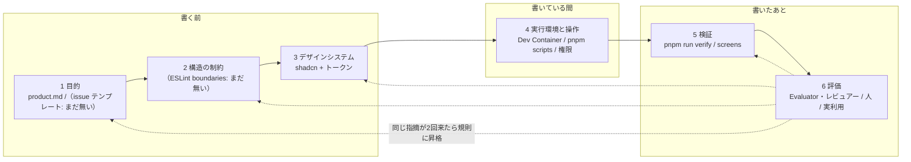
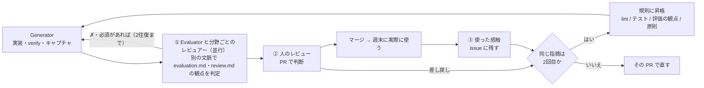

# uma-memo のハーネス

エージェント（または人）に変更を頼んでから PR が上がるまでを支える仕組み全体の設計。
何を作るかの伝え方から、どこに書いてよいか、どう見せるか、何を操作してよいか、
どう確かめるか、良かったかをどう判断して次に活かすかまでを、6つの層に分けて決める。

- 作成日: 2026-09-23 / 最終更新日: 2026-10-12
- **読む場面:** ハーネスの仕組みそのものを変えるとき。lint の規則・検査を足すとき。
  日々の作業では読まなくてよい（要ることは AGENTS.md の目次から各文書へ）
- **ここに無いもの:** 作業の手順と完了の条件は [AGENTS.md](../AGENTS.md)、検証の仕組みの使い方は [testing.md](./testing.md)、
  評価の手順と観点は [evaluation.md](./evaluation.md)、レビューの手順と観点は [review.md](./review.md)、
  依存の向きの表と機能の並びは [architecture.md 第2章](./architecture.md)、見た目の決まりは [design-system.md](./design-system.md)、
  何を作るかは [product.md](./product.md)

---

## 0. 目的と、層の分け方

**人に回すのは「見た目と使い心地が意図どおりか」の判断だけにする。**

機械で確かめられることは、PR が上がる前に全部機械で確かめ終えている状態を作る。
適用する依頼の範囲は [AGENTS.md「目指す状態」](../AGENTS.md#目指す状態) に従う。
検証を完了できない場合は [testing.md 1-2](./testing.md#1-2-検証を完了できないとき) に従い、未完了として引き継ぐ。
そのために、エージェントが迷ったり間違えたりする場所を6つに分け、層ごとに
「正はどこに書いてあるか」「機械がどこまで強制するか」「人は何を判断するか」を決める。

```
┌────────────────────────────────────┐
│ 1. Goal / Product Context          │  何を・なぜ作るか
├────────────────────────────────────┤
│ 2. Architecture Constraints        │  どこに・どう実装してよいか
├────────────────────────────────────┤
│ 3. Design System                   │  どう見せるか
├────────────────────────────────────┤
│ 4. Tools / Runtime                 │  何で開発・検証を動かすか
├────────────────────────────────────┤
│ 5. Verification                    │  正しく動くか
├────────────────────────────────────┤
│ 6. Evaluation / Feedback Loop      │  良い UI・UX なのか
└────────────────────────────────────┘
```

上の3層は「書く前に知っておくこと」、第4層は「書く・確かめるための実行環境」、第5・6層は「書いたあとに確かめること」。
第6層で見つかった指摘は、同じ指摘が二度と来ないように上の層の規則へ戻す（→ 6-4）。
6層の知識を、エージェントがどの順でどこから読むかは第7章「コンテキストの設計」で決める。



### 各層の現状

| 層 | 正（どこに書いてあるか） | 機械の強制 | 現状 |
| --- | --- | --- | --- |
| 1 目的 | README / product.md | なし | 仕様はあるが、「誰がどの場面で使うか」と UX の原則が文になっていない（原則は 1-3 の草案だけ） |
| 2 構造 | architecture.md 第2章 | **なし**（言葉の約束だけ） | 違反がある（→ 2-5） |
| 3 見せ方 | design-system.md / `layout.css` / `components/ui/` | なし | パレットの生の色指定が数百箇所残る。shadcn のトークンが半分しか使われていない |
| 4 操作 | AGENTS.md「コマンド」/ README.md「セットアップ」 | なし | Dev Container と `pnpm run setup` は稼働中。本番に触るコマンドの禁止は言葉だけ（権限の deny と hook はまだ無い） |
| 5 検証 | testing.md | `pnpm run verify` / CI | 稼働中 |
| 6 評価 | evaluation.md / review.md | `pr-body.yml`（評価の欄と、`review:plan` が選んだレビュアーの結果があるか） | Evaluator と分野ごとのレビュアーが PR の前に見る。指摘を規則に戻すのは人の判断（6-4） |

**機械の強制が無い層は、エージェントが読み落とした時点で破られる。** この設計の中心は、
第2層と第3層の約束を ESLint に落とし、`pnpm run lint`（＝ `verify` と CI）で止めることにある。
どの層をどの順で入れるかは第9章。

---

## 1. Goal / Product Context — 何を・なぜ作るか

### 1-1. 役割

エージェントが「この変更で誰の何が良くなるか」を知った状態で書き始めるようにする。
これが無いと、指示の字面は満たしているが使う場面に合わない画面ができる
（例: スマホで観戦しながら書くのに、横に長いフォームを作る）。
第6層の評価も、ここに書いた原則を物差しにする。

### 1-2. 正の置き場

| 文書 | 中身 | 状態 |
| --- | --- | --- |
| [README.md](../README.md) | 何のアプリか・いまのフェーズ | ある |
| [product.md](./product.md)（旧 design.md） | 要件・やらないこと（画面ごとの仕様は pages.md、データモデルは data-model.md） | ある |
| product.md の冒頭 | 誰が・どの場面で・何のために使うか。UX 原則（1-3） | **まだ無い**（足す） |
| **`.github/ISSUE_TEMPLATE/`** | 変更の頼み方の型 | **まだ無い**（足す） |

product.md は仕様の詳細で長いので、UX 原則は冒頭の1画面に収め、エージェントが最初に読む入口にする。

### 1-3. UX 原則（草案）

product.md・pages.md とこれまでの PR で下された判断から拾った。番号は PR や Evaluator の評価（→ [evaluation.md 第3章](./evaluation.md)）から
`P3` のように引くためのもの。

| # | 原則 | 根拠 |
| --- | --- | --- |
| P1 | **ふりかえりは1画面・1送信。** 全頭分を1画面で書き、1回で保存する | pages.md の `/races/[id]` |
| P2 | **既定は閉じる。** 他人のメモはどこにも出ない。共有は1件ずつ、明示の操作で | product.md 第2章 2-2 |
| P3 | **時間で入口を分ける。** 開催前は予想、開催後はふりかえり。その時に要らない操作は出さない | pages.md の `/races/[id]/preview` |
| P4 | **毎回踏む導線だけ出しっぱなし。** それ以外は畳む（アカウントメニュー、`⋯`） | pages.md のヘッダ / 共有や予想画面の操作を `⋯` に畳んだ変更 |
| P5 | **スマホで書ける。** 390px で横にはみ出さず、片手で押せる | 画面カタログの mobile 幅 |
| P6 | **書きかけを失わない。** 送信前に画面を離れても戻せる | `DraftKeeper` |
| P7 | **色だけに意味を持たせない。** 枠・印・グレードは必ず文字も出す | `BracketBadge` のコメント |

これは草案で、正にするのは product.md の冒頭に入れる PR で人が確かめてから（第9章 #5）。
それまでは Evaluator の Product の観点も、この草案を物差しにする。

### 1-4. 頼み方の型 — issue テンプレート（まだ無い）

指示が「〜を直して」だけだと、エージェントは受け入れ条件を自分で作るしかない。
issue を次の型で書けば、そのまま PR の「なぜ」と第6層の評価の物差しになる。

```yaml
# .github/ISSUE_TEMPLATE/change.yml（案）
- 場面: いつ・どの端末で・何をしようとしているとき
- 困っていること: いま何が起きていて、なぜ困るか
- できたら: 何ができるようになれば良いか（見た目の案ではなく結果で）
- 関係する原則: P1〜P7 から（無ければ「新しい原則が要るか」を書く）
- 受け入れ条件: 箇条書き。E2E か画面カタログの1行に落とせる粒度で
```

### 1-5. 機械の強制

この層は文章なので機械では止めない。代わりに、PR テンプレートの「なぜ」に
関係する原則の番号を書かせ、第6層の Evaluator と人のレビューで見る
（テンプレートへの追記は第9章 #5 で入れる。今のテンプレートには無い）。

---

## 2. Architecture Constraints — どこに・どう実装してよいか

### 2-1. 役割

「この処理はどのファイルに書いてよいか」「どこからどこを import してよいか」を
**CI で止める**。architecture.md 第2章の依存の向きはいま言葉の約束だけで、実際に破られている（→ 2-5）。
エージェントは近くにある既存コードを真似て書くので、一度破られた約束はそのまま増える。

依存の向きは **縦（層）と横（機能）の2軸**で決め、どちらも一方向にする。

### 2-2. 規則の中身 — architecture.md 第2章

**import してよい先の表と機能の並びは [architecture.md 第2章「依存の向き」](./architecture.md) を正にする。**
エージェントが書くときに読むのはそちらで、この文書は「どう止めるか」だけを持つ。
boundaries の設定（機能の順序の配列を含む）は architecture.md の表と並びから作り、両者を揃える。
ルート（`src/routes/`）は機能を組み合わせる場所なので、横の軸の制約は受けない。

パッケージ単位の禁止（`@sveltejs/kit`・`$app/*`・`drizzle-orm`・`arctic` を使ってよい場所）は ESLint 標準の
`no-restricted-imports` を `files` ごとに掛ける。ファイル間の向きは次の 2-4 のプラグインで見る。

### 2-3. 機能をディレクトリで表す

ファイル名から機能を推すのは規則に書けないので、
component と utils は architecture.md 第2章の機能の並びに合わせたディレクトリ（`components/races/` など）に移す。
共有のもの（`components/ui/`・`AccountMenu` などの shell、`utils` の `date` / `redirect` / `role`）は shared のディレクトリに置く。
service はもともと1機能1ファイルなのでそのまま。どのファイルをどこへ移すかの一覧は、移す PR で作る。

どのディレクトリにも当たらないファイルは `boundaries/no-unknown-files` で落とす。
新しいファイルを足すときに、どの層・どの機能かを決めることを強制するため。

### 2-4. 検査の仕組み — eslint-plugin-boundaries（まだ無い）

`eslint-plugin-boundaries` を入れ、`pnpm run lint` の中で回す。CI の「整形と lint」の段で
そのまま止まるので、ワークフローは変えない。

**dependency-cruiser ではなくこれを選んだ理由。** 両方をこのリポジトリに当てて比べた。

| | dependency-cruiser 18.4 | eslint-plugin-boundaries 7.2 |
| --- | --- | --- |
| `.svelte` の読み方 | Svelte コンパイラに通してから読む | svelte-eslint-parser の構文木をそのまま読む |
| `.svelte` の `import type` | **コンパイルで消えて見えない** | 見える |
| `PastRuns.svelte` → `services/races` の違反（当時あったもの） | **検出できない** | 検出した |
| 実行の場所 | 別コマンド・別の段 | `pnpm run lint` に入る。エディタにも出る |
| 循環の検出 | ある | 無い（順位で並べるので要らない） |

画面側からサーバーの型を引く違反が実際にあり、それを見逃すツールでは目的を果たせない。

規則の書き方の骨子（v7 の書式で動くことを確認済み）:

```js
settings: {
  'import/resolver': { typescript: { project: './tsconfig.json' } }, // $lib を解決する
  'boundaries/elements': [
    // capture は pattern の * を順に拾う
    { type: 'component', pattern: 'src/lib/components/*/*.svelte', capture: ['feature'] },
    { type: 'service', pattern: 'src/lib/server/services/*.ts', capture: ['feature'] },
    // …層ごとに1行
  ],
  'boundaries/ignore': ['**/*.spec.ts'] // テストは対象の隣に置くので規則の外に出す
},
rules: {
  'boundaries/dependencies': [2, { default: 'disallow', policies: [
    ...layerPolicies,     // architecture.md 第2章の縦の表
    ...featurePolicies    // 同じく横の並びから生成。左 → 右 を disallow
  ] }],
  'boundaries/no-unknown-files': 2
}
```

試して分かった注意点:

- **policies は後ろに書いたものが勝つ。** 機能の禁止（disallow）は層の許可（allow）より後ろに置く
- `captured` に `{ anyOf: [...] }` を書くとプラグインが落ちる。1機能1 policy で生成する
- spec ファイルを `ignore` しないと `notes.spec` という機能として扱われる
- `mode: 'full'` は非推奨。`partialMatch: false` を使う

違反のメッセージには policy の `message` で「なぜ駄目か・どこに置けばよいか」を返す。
エージェントはエラー文を読んで直すので、規則名だけより直りが早い。

### 2-5. 今ある違反

**規則を入れる PR で、`pnpm run lint` が出す違反を全部直す**（件数が少ないので、抑制して先送りしない）。
固定の一覧はコードが動くとすぐずれるので持たない。規則を試しに当てたときに出たのは次の2件で、まだ残っている。

- `src/routes/settings/admin/+page.server.ts` が `drizzle-orm` で直接 SQL を組む（ユーザー凍結を service に移す）
- `src/lib/server/services/notes.ts` が `utils/dashboard` の型（`WatchSourceRow`）を使う（notes → dashboard の向き。型を notes 側に置く）

ほかに、grep で見つかっていて規則ではまだ確かめていないもの: `src/lib/utils/paged-list.svelte.ts` が `$app/navigation` を import している
（pure は `$app/*` を使わない）。どの機能にも割り当てていない service（第8章）は、所属を決めるまで機能の規則を当てられない。

### 2-6. ランタイム上の約束との関係

architecture.md 第0章「守ること」のうち、この層の規則で止まるようになるものと、残るもの。

| 約束 | 止め方 |
| --- | --- |
| サービス層は SvelteKit を import しない | **規則で止まる**（2-2） |
| 画面側はサーバーのコードを型ですら import しない | **規則で止まる**（2-4。`import type` も見える） |
| 認証の判断は `hooks.server.ts` に閉じる | 一部。`auth` を import してよいのを endpoint に限る |
| `lib/server/mcp` は SvelteKit・auth・`drizzle-orm` を import しない | **規則で止まる**（パッケージの禁止と boundaries） |
| メモを読む関数は `viewerId` を必須で受け、WHERE に入れる | 規則では止まらない。単体テストと E2E（他人の id で開けない）で見る |
| D1 クライアントはリクエストごとに作る | 規則では止まらない。`createDb` をモジュールスコープで呼ぶのを `no-restricted-syntax` で止めるのが候補 |
| 1リクエストの D1 クエリは10以内 | 第5層で数える（→ 5-4） |

ほかの約束（`/mcp` は Bearer だけ、Worker は外部のデータ元へ行かない、など）の止め方は、boundaries を入れる PR で決める。

---

## 3. Design System — どう見せるか

### 3-1. 役割

エージェントが画面を書くときに、色・大きさ・部品を**選ぶだけ**で済むようにする。
いまは `text-gray-500` のような生の色が数百箇所あり、画面ごとに少しずつ違う灰色や赤が
使われている。エージェントは近くの画面を真似るので、揺れはそのまま増える。

shadcn-svelte を前提に「① トークン → ② shadcn の部品 → ③ ドメイン部品」の3段で組み、
**下の段にあるもので済むなら上の段を作らない。**

### 3-2. 決まりの中身 — design-system.md

**トークンの表・部品の選び方・ドメイン部品の一覧・大きさと文言の決まりは
[design-system.md](./design-system.md) を正にする。** この文書は、その決まりを
どう止めるか（3-3）と、今の生の色をどう移すか（3-3 の後半）だけを持つ。

要点:

- 色は意味で呼ぶ。shadcn のトークン（`text-muted-foreground`・`border-border`・`bg-muted`・`destructive`）で足りないものは
  アプリ固有のトークン（`--warning`・`--success`・`--info`・`--bracket-1〜8`・`--grade-g1〜g3`・`--text-2xs`）として足す
- 枠色とグレードは外の世界で決まっている色なので、トークンにして1箇所に閉じ込める
- `components/ui/` は `pnpm exec shadcn-svelte add` で入れ、手で直さない。素の `<button>` `<select>` `<textarea>` を書かない
  （画面側にまだ残っている）

### 3-3. 機械の強制（まだ無い）

| 決まり | 止め方 | 確認 |
| --- | --- | --- |
| 素の `<button>` `<select>` `<textarea>` を画面に書かない | `svelte/no-restricted-html-elements`（eslint-plugin-svelte に入っている） | 規則があることは確認済み |
| パレットの色名を使わない（`(bg\|text\|border\|ring\|fill)-(gray\|red\|…)-\d+`） | `eslint-plugin-better-tailwindcss` の `no-restricted-classes` | **未確認**。Svelte 5 と Tailwind v4 で動くかを実装の PR で最初に確かめる。動かなければ正規表現で探す小さなスクリプト（`scripts/check-design.ts`）を `lint` に足す |
| 任意値（`text-[11px]`）を使わない | 同上 | 同上 |
| `components/ui/` を手で直さない | 規則では止めない。lint の対象外にしてあるので、差分があれば PR で見て分かる | — |

`<input>` は止めない。多くはフォームの `type="hidden"` で、要素名だけでは
区別できないため。hidden 以外は置き換えの PR で `Input` に寄せる。

**置き換えは「見た目が変わらない」ことを機械で確かめながら進める。**
生の色を同じ値のトークンに置き換える PR は、`pnpm run screens <機能名> after` で
**残る画像が0枚**になるはず（→ [testing.md 5-1](./testing.md)。変わらなかった組は自動で消える）。1枚でも残れば
置き換えを間違えている。デザインの変更と置き換えを別の PR にするのはこのため。

**既存の違反は ESLint の一括抑制で凍結してから直す。** 数百箇所を1つの PR で直すと
見比べられないので、規則を入れる PR で `eslint --suppress-rule` により今ある違反だけを
`eslint-suppressions.json` に記録する。新しい違反は即座に落ち、記録された違反は
画面ごとの置き換え PR で減らしていく（`--prune-suppressions` で記録も減る）。
記録の件数は増やさない、を約束にする。

---

## 4. Tools / Runtime — 何で開発・検証を動かすか

### 4-1. 役割

人とエージェントが同じ実行環境で「何を叩けば何が分かるか」を知っていて、
「叩いてはいけないもの」は叩けないようになっている状態を作る。

### 4-2. 操作面

コマンドの一覧は [AGENTS.md「コマンド」](../AGENTS.md#コマンド) と `package.json` の `scripts` が正。
ここには、これから足すものだけを書く。

**`pnpm run preview:e2e` を足す（まだ無い）。** E2E と同じビルドと D1 で上げるコマンド。
開発サーバー（`.dev.vars` に `MOCK_AUTH="1"` を置いた `pnpm run dev`）は手元の D1 を見るので、エージェントがブラウザで
触った画面とキャプチャの画面が一致しない。E2E の webServer（`playwright.config.ts`）と同じ
コマンドを script にして `.claude/launch.json` に載せれば、Claude のブラウザから
キャプチャと同じ状態を操作できる。

### 4-3. 叩いてはいけないもの — 言葉から権限へ（まだ無い）

いま本番に触るコマンドの禁止は architecture.md 第0章と AGENTS.md の文章だけ。これを Claude Code の権限設定で止める。

```jsonc
// .claude/settings.json（コミットする。案）
{
  "permissions": {
    "deny": [
      "Bash(pnpm run deploy:*)",
      "Bash(pnpm run db:migrate:remote:*)",
      "Bash(pnpm run data:import:remote:*)",
      "Bash(pnpm exec wrangler deploy:*)",
      "Bash(pnpm exec wrangler secret:*)",
      "Bash(*--remote*)"
    ]
  }
}
```

書式（途中の `*` が効くか、PowerShell 経由も止まるか）は入れる PR で実際に叩いて確かめる。
Claude Code 以外のエージェントには効かないので、文章の約束は残す。
**最後の防波堤は構造のほう**で、Cloudflare の API トークンは手元にも、PR で走るワークフロー（`ci.yml`・`pr-body.yml`）にも無い。
持っているのは、main か人・Worker の起動でしか走らないワークフロー（`deploy.yml`・`data-import.yml`・`odds-update.yml`・`staging.yml`）だけ。

### 4-4. 書いている間の即時の手応え — hook（まだ無い）

`verify` は数分かかるので、層の違反に気づくのが遅れる。ファイルを書いた直後に、
そのファイルだけを整形して lint する hook を置く。

```jsonc
// .claude/settings.json の hooks（案）
"PostToolUse": [{
  "matcher": "Edit|Write",
  "hooks": [{ "type": "command", "command": "node scripts/hook-lint-file.ts" }]
}]
```

`scripts/hook-lint-file.ts` は、書かれたファイルが `src/` 以下なら `prettier --write` と
`eslint` をそのファイルにだけ掛け、違反があれば出力をエージェントに返す。
第2層・第3層の規則がここで効くので、import を1行書いた時点で「その向きは駄目」と分かる。

### 4-5. 実行環境の前提

- [`.devcontainer/devcontainer.json`](../.devcontainer/devcontainer.json) は、人・Claude Code・Codex・CI の環境差を減らすための第4層 **Tools / Runtime** であり、検証の合否は決めない。
  中身と起動方法、Dev Container が無いときの代替手順は [README.md「セットアップ」](../README.md#セットアップ) を正にする
- 検証の入口 `pnpm run verify` と CI の検査は第5層 **Verification** に置く。Dev Container の作成や `setup` の成功を `verify` の代わりにしない
- 本番 D1・シークレット・デプロイの権限を Dev Container に渡さず、自動セットアップでも実行しない
- Windows と Linux の両方で動くこと。script は `node --experimental-strip-types` で書き、シェルに依存しない

---

## 5. Verification — 正しく動くか

稼働中。**仕組みの説明と使い方は [testing.md](./testing.md) を正にする**（テストの置き場、E2E 専用の D1、seed、
画面カタログ、キャプチャの撮り方と比べ方、決定性の約束、限界）。この文書は、なぜこう組んだかの要点と、これから足す検査だけを持つ。

### 5-1. 組み方の要点

- **1コマンドで全部確かめられる。** `pnpm run verify` が green なら、型・整形・lint・単体テスト・
  E2E（画面が開けること、認可、CSRF を含む）は通っている。CI は同じものに `data:check` を足して回す
- **キャプチャは誰が撮っても同じになる。** E2E 専用の D1 を毎回 seed から作り直し、手元の開発データを写さない
- **見せるのは変わった画面だけ。** after を before と画素で比べ、変わらなかった組は消す
- 第2層・第3層の規則が入ると、`pnpm run lint` に「層と機能の依存の向き」「トークンと部品の使い方」が加わる

### 5-2. 全体の流れ

手順は [AGENTS.md「作業の手順」](../AGENTS.md#作業の手順) が正。評価の要否は [evaluation.md 第0章](./evaluation.md#0-評価が必要な変更)、
レビューは [review.md 第0章](./review.md#0-いつ頼むか)、検証できないときは [testing.md 1-2](./testing.md#1-2-検証を完了できないとき)。

### 5-3. 画面カタログに足す検査（まだ無い）

`screens.e2e.ts` は全画面を2幅で開いているので、1画面ごとに見られる UI の品質はここに足すのが安い。

| 検査 | やり方 | 落とす基準 |
| --- | --- | --- |
| アクセシビリティ | `@axe-core/playwright` を各画面に掛ける | 重大度 `critical` / `serious` だけ。`moderate` 以下は PR に件数を出すだけ |
| 押せる大きさ（P5） | mobile 幅で `a, button, [role=button], input, select, textarea` の外接矩形を測る | 24px 四方未満（WCAG 2.2 の 2.5.8）。インラインの文中リンクは除く |

どちらも初回は既存の違反が出るはずなので、画面ごとの許容リストを `screens.ts` に持たせて
始め、減らしていく（第3層の一括抑制と同じ考え方）。

### 5-4. 1リクエストの D1 クエリ数（まだ無い）

[architecture.md 7-1](./architecture.md) の「1リクエストの D1 クエリは10以内」はいま機械で見ていない。
E2E のビルドだけで、リクエストごとのクエリ数を応答ヘッダ（例: `x-uma-memo-queries`）に載せ、
`screens.e2e.ts` で10以下を確かめる。

- 数えるのは `createDb` に渡すリクエストごとの observer（`locals.monitor.onQuery`）で行う。リクエストごとに作るので
  数もリクエストに閉じる（モジュールスコープに持たない、の約束と両立する）
- ヘッダを付けるのは `wrangler dev --var E2E:1` のときだけ。`MOCK_AUTH` と同じく、
  本番のビルドでは分岐ごと消える形にする

### 5-5. CI の構成

手元の `pnpm run verify` と CI は同じものを回す（CI はそれに `data:check` を足す）。**CI にしか無い検査を作らない**（手元で再現できないと直せない）。
PR 本文の検査も、手元で `pnpm run pr:check` として回せる。

| ワークフロー | ジョブ | 回すもの |
| --- | --- | --- |
| `ci.yml` | 検証 | `data:check` → `check` → `lint`（Prettier・ESLint・`docs:check`）→ 単体テスト |
| `ci.yml` | E2E | `test:e2e`（画面カタログを含む）。キャプチャを artifact `screens` に上げる |
| `pr-body.yml` | 欄が埋まっているか | `scripts/check-pr-body.ts`。テンプレートの欄が空でないかと、選ばれたレビュアーの結果があるか（[review.md 第6章](./review.md)） |

ほかのワークフロー（デプロイ・出走馬データの投入・オッズ・出走馬の取得・ステージング・監視）は [operations.md](./operations.md) と [monitoring.md](./monitoring.md)。

これから lint と E2E に入るもの（ワークフローは変えずに、中身が増える）:

| 層 | 入るもの | 入る場所 |
| --- | --- | --- |
| 2 | 層と機能の依存の向き（boundaries）・パッケージの禁止 | 検証 / lint |
| 3 | パレットの色名・任意値・素の操作部品の禁止 | 検証 / lint |
| 5 | axe・押せる大きさ・1リクエストの D1 クエリ数 | E2E |
| 6 | Evaluator | **人が決める**（第8章） |

---

## 6. Evaluation / Feedback Loop — 良い UI・UX なのか

### 6-1. 役割

第5層は「壊れていないか」までしか見ない。「使いやすいか」「頼まれたものか」は
機械では決めきれないので、**判断の物差しを先に文にしておき**（[evaluation.md](./evaluation.md)・[review.md](./review.md)）、
Evaluator と分野ごとのレビュアー・人のレビュー・実際に使った感触の3段で見る。そして、繰り返し出る指摘を下の層の規則に戻す。

以下は Evaluator 評価が必要で、検証を完了できた変更のフィードバックの流れ。



### 6-2. ① Generator と Evaluator を分ける

評価が要る条件・渡すもの・観点・判定・返す形は [evaluation.md](./evaluation.md)、
分野ごとのレビュアーの起動・重さ・観点・返す形は [review.md](./review.md) が正。ここには、なぜ分けるかだけを置く。

**書いたエージェントに、自分の成果物の合否を付けさせない。** 書いた本人は「こう作ったつもり」を
知っているので、自分の画面を甘く読む。キャプチャを自分で見て確かめる（AGENTS.md 手順5）のは崩れを拾うためで、
合否の判断ではない。合否は、別の文脈で動く Evaluator が付け、Generator の説明や意図の解説を渡さない。
Claude Code での Generator（設計するメインのセッションと implementer）の分け方は CLAUDE.md。

機械で見られる項目（label・contrast・focus の一部）は、axe を入れたら（5-3）機械に移し、Evaluator からは外す。

**Evaluator とは別に、コードそのものを分野ごとのレビュアーに読ませる。**
Evaluator はできあがった画面と振る舞いを見るので、コードの約束（誰のデータかの絞り込み、マイグレーションで消える行、
本番に入るデータ、エージェントへの指示の食い違い）は見落とす。
誰を起動するかとその重さは、差分から機械（`pnpm run review:plan`）で決める。Generator が選ぶと、自分の変更を軽く見積もるため。

### 6-3. ② 人のレビュー

人は PR のキャプチャを見て判断する。差し戻すときは、**どの層の問題かを1語添える**。

| ラベル | 意味 | 直す場所 |
| --- | --- | --- |
| `意図` | やりたいことと違う | 第1層（指示・issue の書き方） |
| `構造` | 置き場所・依存の向きがおかしい | 第2層 |
| `見た目` | 揃っていない・トークンを外れている | 第3層 |
| `壊れ` | 動かない・崩れている | 第5層（なぜ機械で止まらなかったか） |
| `使い心地` | 動くが使いにくい | 第6層（evaluation.md の観点） |

### 6-4. 指摘を規則に昇格する

**同じ指摘が2回来たら、3回目が起きないように下の層の仕組みにする。** 人のレビューで
同じことを言い続けるのが一番高くつくため。**昇格するかは、人が差し戻すときに判断する（エージェントはしない）。**
エージェントは1回目の指摘を覚えておく場所を持たず、2回目だと気づけないため。昇格先は機械で止められるものから選ぶ。

1. lint の規則にできるか（第2層・第3層）
2. テストか画面カタログの検査にできるか（第5層）
3. evaluation.md の観点か、review.md の観点・重さの規則（`scripts/review/rules.ts`）にできるか（第6層）
4. どれも無理なら、原則（product.md）か、第7章の置き場に従って分野の文書の約束にする

昇格したものはこの文書の末尾「昇格の記録」に1行ずつ残す（いつ・どの指摘が・どこに入ったか）。
規則が増えすぎていないか、効いていない規則が無いかを見返せるようにするため。

### 6-5. ③ 使った感触

実際の利用は週末に集中する（architecture.md 第1章）。使って引っかかったことは、
その場で issue に「場面」と「困っていること」だけ書いて残す（型は 1-4。テンプレートはまだ無い）。
清書は平日にやればよい。本番のエラーは Discord の通知と Workers Logs で人が見る（[monitoring.md](./monitoring.md)。エージェントからは見ない）。

---

## 7. コンテキストの設計 — AGENTS.md は知識の目次

### 7-1. 役割

エージェントは作業のたびに AGENTS.md を読む（Claude Code は CLAUDE.md から毎回読み込む）。
ここに全部を書くと、毎回の読み込みが重くなり、関係の無い約束に埋もれて肝心の約束を読み落とす。
逆に分けただけで入口が無いと、要る文書にたどり着けない。

**AGENTS.md は知識の目次にし、詳細は分野ごとの文書に1つずつ置く。** エージェントは
目次から「いま触る分野」の文書だけを開く。

### 7-2. 形

目次そのものは [AGENTS.md「知識の目次」](../AGENTS.md#知識の目次) が正。読む深さは3段にする。

| 段 | 何を | いつ |
| --- | --- | --- |
| 1 | AGENTS.md — 目指す状態、止めてよいとき、手順の骨子、目次 | 毎回 |
| 2 | 分野の文書 — 冒頭の「読む場面」で要否を決め、要る章だけ読む | 触る分野だけ |
| 3 | コードのコメント — その場所に固有の理由（「なぜ 404 か」など） | そのファイルを触るとき |

### 7-3. 書き方の約束

| 約束 | 理由 |
| --- | --- |
| AGENTS.md には詳細を書かない。**120行以内** | 毎回読むものは短くないと読み落とされる |
| 1つの知識は1つの文書にだけ書き、他からはリンクする | 写すと片方だけ直されてずれる |
| どの文書も冒頭を「題 → 1〜2行の説明 → 作成日 / 最終更新日の1行 → 読む場面 → ここに無いもの（どこにあるか）」の順にする | 開く前に要否を決められ、開いたあと他所へ探しに行ける |
| 更新の履歴は冒頭に積まない（git log に任せる）。本文にも日付や経緯を書かず、理由だけを残す | 履歴が「読む場面」より前に積もると、毎回読む部分が長くなり、古い経緯が今の約束に見える |
| 約束は理由と一緒に書く | 理由が無いと、例外の場面で判断できない |
| 「書くときに要る決まり」と「なぜそう組んだか・これから入れるもの」を分ける | 前者は frontend / design-system / testing / api / architecture 第0章、後者は product / architecture / harness。日々の作業で後者を読まずに済む |
| まだ無いもの（予定のトークン・規則）は「まだ使えない」と書く | 書いてあるものは使えると読まれる |
| 名前で取り違えない | design.md を product.md に改名したのは design-system.md と紛れるため。画面ごとの仕様を pages.md にしたのは、画面カタログの `e2e/screens.ts` と紛れないため（mcp.md・data-model.md も中身をそのまま名前にした） |
| 文書を足したら AGENTS.md の目次に足す | 目次に無い文書は読まれない |
| CLAUDE.md は AGENTS.md を読み込み、Claude Code 固有のことだけを書く | 他のエージェントと同じ知識を見るため |

### 7-4. 長く自走させるための書き方

Opus 5.5 の使い方の手引き（[Getting the most out of Opus 5.5](https://claude.dev/blog/getting-the-most-out-of-opus-5-5/)）から、
このリポジトリに当てはまるものを取り入れた。

| 取り入れたこと | どこに |
| --- | --- |
| **完了の条件を先に書く。** 何がそろえば終わりかが分かれば、途中で確認を求めずに進められる | AGENTS.md「目指す状態」の完了の条件 |
| **止まる条件を決める。** 確認が要る条件と、検証できないときの引き継ぎを区別する | AGENTS.md「目指す状態」 / [testing.md 1-2](./testing.md#1-2-検証を完了できないとき) |
| 取り消しにくい操作は権限の確認を残す | 今は AGENTS.md と architecture.md 第0章の文章だけ。権限の deny は 4-3 の案で、まだ無い |
| **長い作業は進み具合をファイルに残す。** 会話が要約されても続きを拾える | AGENTS.md「作業の手順」の `TASKS.md`（コミットしない） |
| **サブエージェントの結果は確かめてから採る** | evaluation.md・review.md の手順（指摘をそのまま採らない） |
| **確かめていないものは確かめていないと書く** | evaluation.md の `?`、review.md の「確かめられなかったもの」 |
| 人のレビューの前にエージェントに差分を見させる | 第6層 6-2（Evaluator と分野ごとのレビュアー）。どれにも当たらないコードは `/code-review` も使える |
| **人の判断が要ることを先に読ませる** | PR テンプレートの「レビューで見てほしいところ」を2番目に上げた |
| デザインは「避けたいもの」を並べる | design-system.md 第6章 |
| 「よく考えて」のような指示は書かない（モデルが自分で考える） | 文書と、Evaluator の定義（`.claude/agents/evaluator.md`） |

### 7-5. 機械の強制 — `scripts/check-docs.ts`

`pnpm run lint` の中で回る（＝ `verify` と CI で止まる）。

- 文書の中の相対リンクの先が在る
- `docs/*.md` がすべて AGENTS.md から張られている（目次に無い文書を作らない）
- AGENTS.md が120行以内
- コード・文書に出てくる `〇〇.md` という名前の文書が在る（改名したときの取り残しを拾う）。
  `drizzle/` の生成物は手で直さない約束なので対象外

見出しへのリンク（`#...`）の先までは見ない。日本語の見出しの anchor の作り方が GitHub 次第で、
確かめる手間に見合わない。

---

## 8. 決めたこと・決めていないこと

| 論点 | 決めたこと | 理由 |
| --- | --- | --- |
| 依存の検査ツール | eslint-plugin-boundaries | `.svelte` の `import type` を見逃さない（2-4） |
| 機能の表し方 | 層の下に機能のディレクトリ | SvelteKit の `$lib/server` の保護を保ったまま、規則を glob で書ける |
| 既存違反の扱い（第2層） | 規則を入れる PR で全部直す | 数件しかない（2-5） |
| 既存違反の扱い（第3層） | 一括抑制で凍結して、画面ごとに減らす | 数百箇所あり、1つの PR で見比べられない |
| 見た目の回帰テスト | 入れない | [testing.md 第7章](./testing.md) |
| 規則への昇格 | 人が差し戻すときに判断する | エージェントは2回目だと気づけない（6-4） |

決めていないこと（実装の PR で決める）:

- **機能を最上位のディレクトリにするか。** `src/lib/features/<機能>/` に層を入れる形も
  取れる。機能の境界はこちらのほうが強く見えるが、サーバーのコードが `$lib/server` の外に出るので
  `*.server.ts` の命名で守ることになる。今は移動の少ない「層の下に機能」を選んでいる
- **share と dashboard を service で分けるか。** レースの共有は `services/race-shares.ts` に分かれているが、
  メモ単位の共有（`getSharedNote`・`setNoteVisibility`・`listSharedNotes`）とダッシュボードの `listWatchSources` は
  `services/notes.ts` に残っている。分けるのは、機能の向きの規則が効き始めてから、違反の出方を見て決める
- **機能の並びに入っていない service の所属。** `favorites`・`profile`・`mcp-usage`・`race-shares`・`entries-fetch`・`lists` が
  architecture.md 第2章のどの機能（または shared）に入るかは未決。boundaries を入れる PR で決め、architecture.md に足す
- 第3層の lint を ESLint プラグインにするか、自前のスクリプトにするか（3-3 の確認次第）
- **Evaluator を CI で自動で回すか。** PR ごとに GitHub Actions から回す形（`anthropics/claude-code-action` など）も取れるが、
  API キーをリポジトリのシークレットに置くことになり、料金もかかる。シークレットの扱いは人が決める約束
  （architecture.md 第0章）なので、今は手元で Generator が呼ぶ形にし、CI に載せるかは人が決める

---

## 9. 入れる順番

1つの PR で1つの層を入れる。前の PR の仕組みが次の PR の検証に効くよう、この順にする。

| # | PR | 層 | 中身 | 画面への影響 |
| --- | --- | --- | --- | --- |
| 0 | コンテキストと評価（**済み**） | 5 / 6 / 7 | AGENTS.md を目次にし、分野の文書に分けた。`docs:check`・Evaluator のサブエージェント・`pr-body.yml`。分野ごとのレビュアーと `review:plan` | なし |
| 1 | 依存の規則（まだ） | 2 | boundaries と resolver を入れる。component / utils を機能のディレクトリへ移す。2-5 の違反を直す | なし（キャプチャ0枚を確かめる） |
| 2 | 操作と即時の手応え（一部済み） | 4 | **済み:** Dev Container と `pnpm run setup`。**まだ:** `.claude/settings.json`（deny と hook）、`preview:e2e`、`.claude/launch.json` | なし |
| 3 | トークンと lint（まだ） | 3 | design-system.md 2-2 のトークンを足し、「今使えるもの」に移す。lint 規則と一括抑制 | なし |
| 4〜 | 画面ごとの置き換え（まだ） | 3 | 生の色と素の操作部品をトークンと shadcn に置き換える。1画面か1機能ずつ | **無いことを確かめる**（残る画像0枚） |
| 5 | 目的の型（まだ） | 1 | product.md の冒頭に UX 原則、issue テンプレート、PR テンプレートの「なぜ」に原則の番号 | なし |
| 6 | 画面カタログの検査（まだ） | 5 | axe、押せる大きさ、D1 クエリ数、カタログに無い admin の画面（`/races/new`・`/races/[id]/entries`。`/settings/admin` はもうある） | なし |

2 を 3 より先にするのは、hook があると置き換え中の違反がその場で分かり、4 以降の PR が速くなるため。

---

## 昇格の記録

6-4 で規則に昇格した指摘。

| 日付 | 指摘 | 入れた先 |
| --- | --- | --- |
| — | — | — |
