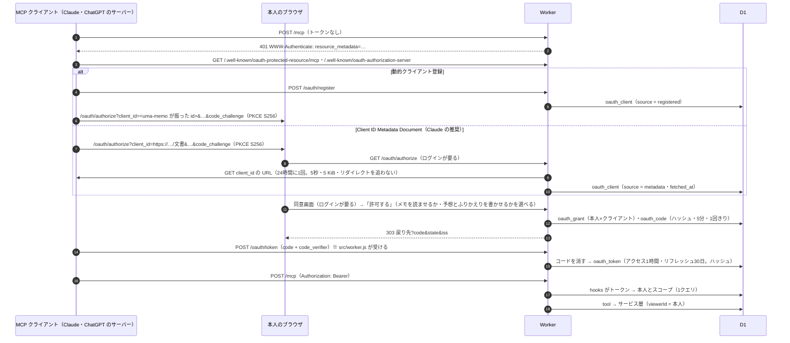

# uma-memo の MCP と OAuth — AI のクライアントとの連携

Claude・ChatGPT（スマホのアプリを含む）が、本人の許した範囲だけを読み書きするための口。
サーバーの MCP（`/mcp`）とその認可サーバー（OAuth 2.1）と、ブラウザの中で動く WebMCP をまとめる。

作成日: 2026-10-12 / 最終更新日: 2026-10-12

- **読む場面:** MCP の tool・スコープ・回数の上限を足す・変えるとき。OAuth の口（`/.well-known/*`・`/oauth/*`）、
  同意画面（`/oauth/authorize`）、連携の一覧（`/settings/connections`）を触るとき。予想画面の WebMCP を触るとき（第7章）
- **ここに無いもの:** 認証の規則（`/mcp` は Bearer だけ・Bearer は `/mcp` だけ・`/oauth/token` の例外）と、
  利用者の渡した URL へ取りに行く規則は [architecture.md 第0章](./architecture.md)。
  ルートの一覧（ほかの口と並べた入力・成功・失敗）は [api.md 第3章](./api.md)、
  テーブル（`oauth_client`・`oauth_grant`・`oauth_code`・`oauth_token`・`mcp_usage`）は [data-model.md](./data-model.md)、
  E2E の環境は [testing.md](./testing.md)、ログと通知は [monitoring.md](./monitoring.md)

**書けるのは本人の予想（見立て・印・札・出走前メモ）と、開催日以降（当日を含む）のレースのふりかえり（レースのメモ・各馬のメモと札）だけ。**
近況メモ・展開を書く tool と、共有する・消す tool とスコープは無い。

---

## 1. 経路と置き場所



| 層 | 置き場所 | 持つもの |
| --- | --- | --- |
| 案内 | `routes/.well-known/*`・`lib/server/auth/oauth-metadata.ts` | RFC 9728 / RFC 8414 のメタデータ（公開。DB に触らない） |
| 登録 | `routes/oauth/register/+server.ts` | 公開クライアントだけを登録（戻り先は https かループバック） |
| 文書の取得 | `lib/server/auth/client-metadata.ts` | Client ID Metadata Document の取得・検証・24時間の保存・未連携の行の上限と掃除 |
| 同意 | `routes/oauth/authorize/` | 要求の検証・スコープの選択・コードの発行。枠に入れさせない（`X-Frame-Options`） |
| トークン | `src/worker.js` → `lib/server/auth/token-endpoint.ts` | フォームの読み取り・`resource` の確認 |
| 認可の中身 | `lib/server/auth/oauth.ts` | PKCE・コードとトークンの発行と検証・リフレッシュのローテーション・連携の一覧と解除 |
| 入口の判断 | `hooks.server.ts` | `/mcp` だけ Bearer を検証し、`locals.user` と `locals.oauthScopes` を載せる |
| MCP | `routes/mcp/+server.ts` → `lib/server/mcp/` | JSON-RPC（initialize / ping / tools/list / tools/call）。スコープが足りなければ 403 `insufficient_scope` |
| 解除 | `/settings/connections` | 本人の連携の一覧と解除（CASCADE でコードとトークンも消える）・今週の利用量（%） |
| 上限 | `lib/server/services/mcp-usage.ts`・`lib/utils/mcp-quota.ts` | 週ごとの回数の上限（`mcp_usage`。1人1行）。数字と週の区切りは `mcp-quota.ts` だけに置く |

- **トークンの口だけ SvelteKit に通さない。** トークンの要求は Origin の無いフォームの POST で、SvelteKit の CSRF の検査が
  hooks より前に 403 にする（パスごとに外す設定は無い）。この口は Cookie を見ないので、検査が守るものが無い。
  `hooks.server.ts` に足したもの（レート制限など）はこの口には効かない。
  `vite dev` では `src/worker.js` を通らないので、この口は 404 になる（E2E は `wrangler dev` で通る）
- MCP はステートレスで、応答は JSON（SSE なし）。公式 SDK を使わないのは `nodejs_compat` を付けないため（[architecture.md 第0章](./architecture.md)）
- 同意画面の GET の `load` は `oauth_client` に書く。取ってきた文書のキャッシュにあたり、本人の権限は何も変えない
  （load は D1 に書かない、の例外。許可は form action の `POST`）

### 1-1. 口ごとの入力と応答

ルートの一覧での短い行は [api.md 第3章](./api.md)。ここはその詳細。

| パス | 入力 | 成功 | 失敗 |
| --- | --- | --- | --- |
| `GET /.well-known/oauth-protected-resource`（と `/mcp` 付き） | — | 保護されたリソースのメタデータ（RFC 9728）。`resource`・`authorization_servers`・`scopes_supported` | — |
| `GET /.well-known/oauth-authorization-server` | — | 認可サーバーのメタデータ（RFC 8414）。PKCE は S256 だけ・公開クライアントだけ。`client_id_metadata_document_supported: true`（動的登録と Client ID Metadata Document の両方を受ける） | — |
| `POST /oauth/register`（JSON） | `client_name`・`redirect_uris`（1〜5。https かループバックの http）・`token_endpoint_auth_method`（`none` だけ） | `201` と `client_id`。何の権限も持たない | `400 invalid_redirect_uri` / `invalid_client_metadata`・`413` 本文超過・`429 temporarily_unavailable` 登録上限（`Retry-After: 60`。上限と期限は第6章） |
| `POST /oauth/token`（フォーム） | `grant_type=authorization_code`（`code`・`redirect_uri`・`client_id`・`code_verifier`）か `refresh_token`（`refresh_token`・`client_id`・`scope` で狭められる）。`resource` は自分の `/mcp` だけ | アクセス（1時間）とリフレッシュ（30日・1回きり。送り直しの扱いは第5章）。`no-store` | `400 invalid_grant`（コードの再利用・PKCE・戻り先・期限・別のクライアント）/ `invalid_scope` / `invalid_target` / `unsupported_grant_type`。使い回されたリフレッシュトークンは連携ごと消す。同時更新の競合は連携を保持して `503 temporarily_unavailable`（`Retry-After: 1`） |
| `GET /oauth/authorize`（ログインが要る） | `response_type=code`・`client_id`・`redirect_uri`・`code_challenge`・`code_challenge_method=S256`・`state`・`scope`・`resource` | 同意画面（アプリの名前・戻り先のホスト・スコープ。Client ID Metadata Document なら提供元のホスト）。`client_id` が HTTPS の URL なら、その文書を取りに行く（24時間は保存した内容を使う）。`X-Frame-Options: DENY`・`no-store` | 要求の誤り（クライアント・戻り先・PKCE・`response_type`・`resource`）は**戻り先へ飛ばさず**画面に出す（第2章） |
| `POST /oauth/authorize` `default` | GET と同じ項目（hidden）・`decision`（`allow`\|`deny`）・`scope_grant`（複数） | `303` 戻り先に `code`・`state`・`iss`。拒否なら `error=access_denied`。同じクライアントへの前のトークンは消す | 要求の誤り `fail(400)`（画面に出す） |
| `POST /mcp`（JSON-RPC 1件。Bearer） | `initialize`・`ping`・`tools/list`・`tools/call`、通知 | JSON で返す（SSE なし）。通知は `202`。tools/list はトークンのスコープで呼べる tool だけ | トークンなし・無効 `401`（`WWW-Authenticate: Bearer resource_metadata=…`）/ Bearer はあるが DB に届かない `503 temporarily_unavailable`（401 にするとクライアントがトークンを捨てる）/ スコープ不足 `403`（`WWW-Authenticate: … error="insufficient_scope", scope="…"`）/ 別オリジンの `Origin` `403` / 壊れた JSON・バッチ・知らない `MCP-Protocol-Version` `400` / 本文が64 KiBを超える `413` / tool の入力の誤り・見つからない・回数の上限は `200` の `isError: true` |
| `GET`・`DELETE /mcp` | — | — | `405`（サーバーから流す SSE とセッションは持たない） |

- `/oauth/register`・`/oauth/token` の本文は読み取り中に 8 KiB、`/mcp` は 64 KiB（書く tool がレースのメモと出走馬ぶんの本文を運ぶ）で止め、超えたら 413。
  Content-Length が無い場合や小さく偽った場合も同じ上限を使う（`auth/limited-body.ts`）

---

## 2. 書くときの決まり

- **tool やスコープを足したら、テストも同じ形で足す。** スコープが足りないトークンでは tools/list に出ず 403 になること、
  別のユーザーのトークンでは相手のデータしか返らないこと（入力で相手を選べないこと）を、単体（`mcp/protocol.spec.ts`）と
  E2E（`e2e/mcp.e2e.ts`）の両方で確かめる
- **`viewerId` はトークンの持ち主。** 入力からは受けない。入力は余計な項目を受けない `strictObject` にする
- **返す項目は tool で1つずつ選ぶ。** サービスの戻り値を広げて返さない（書いた人の名前・公開範囲・`created_by`・`profile_memo` を出さない）
- **tool はサービス層を呼ぶだけ。** SQL は書かない。書く tool は form action と同じサービス関数（`savePreviewNotes`・`saveRaceReview`）を呼ぶ
- **同意画面は、要求の誤りで戻り先へ飛ばさない。** 登録は誰でもでき、戻り先は https ならどこでも登録できるので、
  誤りで飛ばすとオープンリダイレクトになる。戻り先へ送るのは本人が「許可する」「許可しない」を押したときだけ
- **利用者が渡した URL へ取りに行くのは CIMD の取得だけ。** ほかの口で足さない（[architecture.md 第0章](./architecture.md)・第6章）

---

## 3. スコープと tools

### 3-1. スコープ

`races:read`（マスタ。外せない）と `notes:read`（本人のメモ。同意画面で外せる）と `notes:write`（本人の予想を書く。同意画面で外せる）と `reviews:write`（本人のふりかえりを書く。同意画面で外せる）。

- 予想とふりかえりを別のスコープにしたのは、`notes:write` で許した連携に黙ってふりかえりの書き込みを足さないため（`note` でも別の行）
- 足りない tool は tools/list に出さず、呼ばれたら動かさずに 403。`races:read` だけのときは、レースの一覧に添える「自分のメモの件数」も出さない
- `notes:write`・`reviews:write` が加わる前の連携は持っていないので、書かせるには本人が連携し直す（スコープは更新で広がらない）

### 3-2. tools

| tool | スコープ | 入力 | 返すもの |
| --- | --- | --- | --- |
| `search_races` | `races:read` | `q`・`year`・`limit`（1〜50） | レース（新しい順）。`notes:read` もあれば `myNoteCount`（自分のメモの件数） |
| `get_race` | `races:read` | `raceId` | レースの条件・出走馬（馬番・騎手・着順）・オッズとその時点 |
| `get_horse` | `races:read` | `horseId`・`limit`（1〜100） | 馬のプロフィール（性・生年・生年月日・調教師・父母・母父）と出走歴 |
| `get_my_race_notes` | `notes:read` | `raceId` | そのレースの自分の見立て・ふりかえり・各馬のメモ・印・札・展開 |
| `get_my_horse_notes` | `notes:read` | `horseId` | その馬の自分のメモ |
| `list_my_recent_notes` | `notes:read` | `limit`（1〜50） | 自分の最近のメモ |
| `save_my_race_preview` | `notes:write` | `raceId`・`raceNote.body`・`entries`（〜40。`entryId` と、`body`・`mark`（null で外す）・`tags` のうち書き換えるもの） | 書いた結果（`raceNote` は `saved`・`cleared`・`unchanged`、馬ごとは `saved`・`cleared`）。本文は返さない。`body` は追記でなく置き換え。出走馬でない `entryId`・空の入力は何も書かずに `isError` |
| `save_my_race_review` | `reviews:write` | `raceId`・`raceNote.body`・`entries`（〜40。`entryId` と、`body`・`tags` のうち書き換えるもの。印は運ばない） | 書いた結果（形は `save_my_race_preview` と同じ）。本文は返さない。`body` は追記でなく置き換え。開催前のレース・出走馬でない `entryId`・空の入力は何も書かずに `isError` |

### 3-3. 予想を書く tool（`save_my_race_preview`）

**渡した見立て・渡した馬の渡した項目だけを書き換える。** 省いた項目は今の値で埋め、
省いた馬と見立てには触らない（AI が一部だけ渡して、ほかの馬のメモが消えないように）。本文・印・札がすべて空になった馬は消える（画面の保存と同じ）。

- 出走馬は DB を正とする。`entryId` がそのレースの出走馬でなければ何も書かず、`horse_id` は入力から受けない（予想画面の action と同じ）
- 展開（`flow`）は渡さないので触らない（`savePreviewNotes` に `raceNote.flow` を渡さない）
- 返すのは書いた結果だけで、本文は返さない。見立ての `cleared` は本文を空にしたことで、保存済みの展開があれば行は残る（`raceNoteStatements`）。
  `notes:read` の無い連携に、省いた項目の今の値を見せないため
- tools/list の `annotations` で `readOnlyHint: false`・`destructiveHint: true` を名乗る。クライアントが実行の前に本人に確かめる目安になる

### 3-4. ふりかえりを書く tool（`save_my_race_review`）

上と同じ流儀で、渡したレースのメモ・渡した馬の渡した項目だけを書き換える。違いは次のとおり。

- 書くのはふりかえり画面で書けるものだけ（レースのメモ `race` は本文だけ、出走馬ごとの `entry` は本文と札）。印は運ばない。
  `saveRaceReview` が `race` と `entry` しか書かないので、予想（見立て・印・出走前メモ・展開）には構造的に触れない
- **開催前のレースには書かない。** ふりかえり画面の action と同じ線引き（`isUpcoming(race.date, todayJst())`。当日は書ける）で、
  開催前なら何も書かず tool の誤りを返す。結果（着順）の有無は見ない（画面と同じ。結果の投入が遅れた日でも書ける）
- 本文と札が両方空になった馬のふりかえりメモは消える。レースのメモの本文を空にするとレースのメモも消える
  （`raceNote` は `saved`・`cleared`・`unchanged`）。`raceNote` を省くとレースのメモには触れない（`saveRaceReview` の `raceNote` は省略できる）
- 回数の上限は書き込みの枠を使う（`readOnly: false`）。枠は増やさない

### 3-5. 書く tool に残る弱さ

- AI が読んだメモ・レース名に書かれた指示（プロンプトインジェクション）で呼ばれうる。tool の説明と initialize の
  instructions で「本人が書き込みをはっきり頼んだときだけ」と書いているが、強制はできない。最悪でも本人の予想・ふりかえりの上書きと消去までで、
  近況メモ・他人のメモと、共有の設定（公開範囲）には届かない。ただし本人が共有中のメモ（`/notes/[id]`・予想まとめの共有）は、
  書き換えた本文がそのまま共有先に出て、消せば共有先からも消える（画面で直したときと同じ。upsert は `visibility` に触れない）
- 今の値を読んでから batch で書くまでは1つのトランザクションでない。その間に本人が予想画面・ふりかえり画面で保存すると、
  tool が省いた項目は読んだときの値に戻る。届くのは本人のメモの中だけ

---

## 4. 回数の上限

**tool の呼び出しは、ユーザーごとに週の回数の上限がある**（回数は `lib/utils/mcp-quota.ts` の `MCP_WEEKLY_LIMITS`。読み取りと書き込みで別の枠）。

- 単位は連携でなくユーザー。Claude と ChatGPT をつないでも合算で、連携を作り直しても逃れられない
- 週の区切りは水曜 12:00 JST（UTC+9 固定なので水曜 03:00 UTC）。週が変わったら読み・書きとも 0 から
- 数えるのは `tools/call` で、スコープと入力の検証を通ったあと、tool を動かす前に1つ（tool が「見つからない」を返しても数える）。
  initialize・ping・tools/list・通知・知らない tool 名・403・入力の誤りは数えない。読み取りか書き込みかは tool の `readOnly` で決まる
- **数えるのと判定は1クエリ**（`INSERT … ON CONFLICT DO UPDATE … WHERE … RETURNING`）。読んでから書くと、並んだ呼び出しが上限を超える
- 上限に達したら tool を動かさず、tool の誤り（`isError`、HTTP 200）で戻る日時を返す。JSON-RPC の誤りにすると連携の故障に見える
- 本人は `/settings/connections` で %、管理者は `/settings/admin` で各ユーザーの % を見て、1人ずつ 0 に戻せる（行を消す）。
  管理画面は利用者の活動の量（メモの件数など）を出さない（`routes/settings/admin/+page.server.ts` の load。本文を見せなくても「何か書いている」ことは漏れる）。
  その例外で、出すのは今週の % だけ（リセットの要否を判断するため）。回数・tool の名前・連携の名前は出さない

---

## 5. リフレッシュトークンと同意の世代

### 5-1. 送り直しを受ける

**リフレッシュトークンは1回きり。ただし回線断での送り直しは受ける**（`auth/oauth.ts` の `judgeRetry`）。競馬場のスマホのように
電波の弱い所では、要求は届いたのに応答が届かず、クライアントが同じトークンで送り直すことがある。使用済みのトークンが来たとき:

- **受ける**: 前に使われてから30分（`REFRESH_RETRY_GRACE_SEC`）の内で、そのとき出したアクセストークンが**一度も使われていない**
  （リフレッシュするのは tool を呼ぶためなので、受け取っていればすぐ使う。アクセストークンは初めて使われた時刻を `used_at` に1回だけ残す）。
  届かなかった1組を止め（`parent_id` で辿る）、最初の更新で確定したスコープのまま新しい1組を出す。
  再送で `scope` を省略しても縮小前の権限には戻らず、明示したスコープが最初の更新と異なれば `invalid_scope` で断る。
  Workers Logs に info を残す
- **連携を消さずに断る**: 同じ未使用状態を読んだ別の要求が先に更新したときは `503 temporarily_unavailable` と `Retry-After: 1` を返す。
  トークンを捨てさせる `invalid_grant` と区別する（MCP 公式 SDK は `invalid_grant` でトークンを捨てるが、
  `temporarily_unavailable` では捨てない。ただし `Retry-After` は読まず、次の tool 呼び出しの更新で回復する）
- **盗まれたとみなして連携ごと消す**: 出したアクセストークンが使われた・次のリフレッシュトークンが使われた・30分を過ぎた・
  止めた1組があとで使われた（止めた直後でも待たない）。使用済みの印と子の INSERT は同じ batch で確定するので、
  「印があって子が無い」のは送り直しで止めた1組だけで、処理中と取り違えることは無い。Workers Logs に warn を残す
- **発行をまとめて確定する**: 同意の世代・未使用状態を条件に新しい1組を INSERT し、使用済みの印・届かなかったアクセスの削除・掃除を
  同じ D1 `batch()` で行う。保存が失敗すれば印もロールバックされ、通常更新・送り直しのどちらも元の状態から再試行できる
- 残る弱さ: 正規のクライアントが新しいアクセストークンを初めて使うまで（ふつうは数秒）の間に盗まれた古いトークンが来ると受けてしまう。
  その場合も、正規のクライアントが次に更新したときに見つかって連携ごと消える。
  また、正規のクライアントが同じリフレッシュトークンで同時に2回更新し、後の要求が先の確定のあとに届くと送り直しとして受け、
  先の1組を止める。クライアントが先の応答のほうを残すと、次の更新で盗まれたとみなされて連携が切れる（実クライアントでは未確認）

### 5-2. 同意し直したとき

同意し直したら grant の ID を世代として切り替え、前の grant と子のトークン・コードを CASCADE で消し、新しい grant とコードを同じ batch で作る。
発行の INSERT もその世代が有効か確かめるので、処理中だった古いコード交換・更新・送り直しから以前の権限を復活できない。
同意の保存に失敗したときは、前の連携を維持する。許可した日と最終利用日は新しい同意のものになる。

---

## 6. クライアントの識別と残る弱さ

**クライアントの識別は2通り。** 動的クライアント登録（`/oauth/register`。id は uma-memo が振る）と、
Client ID Metadata Document（CIMD。Claude の推奨。`client_id` が文書の HTTPS の URL。`auth/client-metadata.ts`）。
CIMD は登録の口を通らず、同意画面を開いたときに文書を取りに行き、`oauth_client` に `source = 'metadata'` で入れて24時間使う。

### 6-1. 動的クライアント登録

- 登録は誰でもできるが、全体で直近60秒に100件、**一度も連携していない**登録（`oauth_client.connected_at` が NULL）は1,000件まで。
  条件付き INSERT で判定し、同時要求でも上限を超えない。超過時は 429 と `Retry-After: 60` を返す
- 一度も連携していない登録は作成から24時間で認可に使えなくなり、次の登録要求で期限切れを最大100件ずつ削除する。
  登録が来なければ期限切れの行は残るが、認可には使えない
- **一度でも連携した登録は、連携が解除・使い回しの検出・凍結で消えたあとも消さない。** 公式 SDK は `invalid_grant` で
  トークンだけを捨て、手元の client_id のまま認可に来るので、登録を消すと同じアプリからつなぎ直せなくなる
- この制限は D1 の保存行数と登録頻度を抑えるもので、要求そのものの到達やDB読み取りを止めるものではない。
  全体の上限なので、上限に達すると正規クライアントの新規登録も待つ（既存の連携は引き続き使える）。
  Cloudflare 側のレート制限はこの実装に含めない

### 6-2. Client ID Metadata Document（CIMD）

- **利用者が渡した URL（client_id）へ Worker が取りに行く経路。** 取りに行くのはログインした本人が同意画面を開いたときと「許可する」を押したときだけで、誰でも叩ける口からは行かない。
  URL は https・パスあり・クエリ／フラグメント／認証情報／`.` と `..` のセグメント／IP の直書きなし。リダイレクトを追わず、5秒・5 KiB・JSON だけ。
  取り直しに失敗したら古い内容は使わない
- 文書の `client_id` が URL と完全に一致し、戻り先が https かループバックで、公開クライアント（`none`）として使えるときだけ使う。
  `token_endpoint_auth_method` が無いか `none`、または別の方式（ChatGPT は `private_key_jwt`）でも `token_endpoint_auth_methods_supported` に `none` があればよい。
  案内（認可サーバーのメタデータ）は `none` しか挙げないので、クライアントは `none` で来る想定（実クライアントでは未確認）。
  トークンの口は `client_id` を本文か Basic からしか読まないので、`client_assertion` だけで来ると交換に失敗する。
  `client_assertion` が付いてきても検証せずに捨てる（PKCE・`client_id`・戻り先で判断し、公開クライアントと同じ権限しか出さない）
- 名前は自己申告だが、URL のホストは文書を置いた提供元として確かめられるので、同意画面と「AIとの連携」に「提供元」として出す
- CIMD の行は動的登録の上限に数えず、一度も連携していない CIMD の行を別に1,000件まで（超えたら同意画面で「混み合っています」）。
  取ってから24時間を過ぎた未連携の行は次の取得のときに最大100件ずつ消す。E2E だけ `OAUTH_CIMD_ALLOW_LOOPBACK=1` で `http://localhost` を許す
- 残る弱さ: 本人ごとの取得の頻度は数えていない（ログインした本人が URL を変えて開き直せば、そのたびに取りに行く）。
  同意画面の GET は他サイトから開かせることもできるので、ログイン中の本人に文書を取りに行かせることはできる（できるのは
  取得と未連携の行を1つ増やすことまでで、許可は本人が押さないと出ない）。名前で私的なアドレスを指すホストは形では弾けず、
  Workers の fetch が私的なネットワークへ届かないことに頼っている

---

## 7. WebMCP — ブラウザの中で予想の下書きを受ける

**読む場面:** 予想画面の AI 連携、下書きの部分更新、WebMCP の仕様を変えるとき。
保存 action の仕様は [api.md 第3章](./api.md)、DB の責務は [architecture.md 第0章](./architecture.md)、書き方の約束の要約は [frontend.md](./frontend.md)。

WebMCP は試験的な機能として残す。Claude・ChatGPT から読む安定した経路はサーバーの MCP（`/mcp`。第1〜6章）で、
画面は同意（`/oauth/authorize`）と連携の一覧（`/settings/connections`）だけ。
WebMCP の tool はブラウザ内の読み取りと未保存フォームの更新だけで、HTTP の口は増やさない。保存は既存の action のまま。

使い方はログインした人向けの `/help/webmcp` に置き、MCP の使い方（`/help/mcp`）の末尾からリンクする。
予想画面には置かない（試験的な機能なので、予想を書く画面で目立たせない）。
対応判定は tool と同じ `getModelContext()` を使うが、案内ページでは tools を登録しない。
API の有無だけで AI 接続や登録成功まで確認できたように表示しない。
Chrome の試験設定・Inspector の案内は公式資料を参照し、確認日を画面に載せる。
ブラウザや AI の仕様が合わなければ使えないこと、通常入力は続けられることも説明する。

`/races/[id]/preview` だけで `get_prediction_context` と `apply_prediction_draft` を登録する。
[WebMCP の draft（2026-09-30 版）](https://webmachinelearning.github.io/webmcp/) に従い、
`document.modelContext.registerTool(tool, { signal })` を使い、解除は登録に渡した `AbortController.abort()`。
対応判定と局所的な型は `src/lib/webmcp/support.ts`、tool と取得値の整形は `prediction.ts` に置く。
予想ページの `$effect` は mount 後に登録し、レース ID が変わる SPA 遷移と unmount で解除する。
解除済みのコールバックも `inactive_page` で拒否する。非対応・登録失敗では通常のフォームをそのまま使える。
旧 `navigator.modelContext` API の互換実装や polyfill は入れていない。

### 7-1. 取得

`get_prediction_context` の入力は空オブジェクト。`load` の `race`・`rows`・`sameCondition`・`oddsAsOf` を使い、
レースの条件、各出走馬の ID / 馬 / 騎手、オッズと人気、本人の履歴、過去走を返す。
`oddsAsOf` は ISO 文字列から Unix epoch ミリ秒へ変換し、未取得は null。
`myCurrentPrediction` と追加の `myCurrentRacePrediction` は `DraftKeeper.snapshot()` から現在の入力も読む。
`load` の `user` やセッションは渡さない。`readOnlyHint: true` / `consequentialHint: false` / `untrustedContentHint: true` を設定し、
取得したメモや外部データを指示として扱わない旨も tool の説明に書く。

### 7-2. 反映

`apply_prediction_draft` は `predictionDraftSchema`（Valibot）で受信値を検証する。
公開する JSON Schema もこのスキーマから `@valibot/to-json-schema` で生成し、選択肢・上限を二重管理しない。
未知のプロパティ、未知の印・札・ペース、10000文字を超える本文、盤面外の座標、不完全な flow は拒否する。
本文・札の並び・座標・局面メモの制約は既存の定義を使う。

```ts
type PredictionDraft = {
  race?: { body?: string; pace?: Pace | null; flow?: RaceFlow | null };
  entries: { entryId: string; body?: string; tags?: NoteTag[]; mark?: Mark | null }[];
};
```

`entries` は必須（レースだけなら `[]`）。**未指定は既存値を維持**し、`body: ''`、`mark: null`、`tags: []`、
`pace: null` はその欄を明示的にクリアする。`flow` を指定した場合は pace と3局面（spots / memo）を含む
展開全体を置き換える。`flow: null` は展開全体のクリアで、本文は維持する。
`race.pace` と `flow.pace` を両方指定した場合は `race.pace` を優先する。

`preparePredictionDraft` は `data.rows` の許可 ID で、entries と全局面の spots を**変換前に全部**確かめる。
未知の ID は `{ status: 'rejected', reason: 'unknown_entry', entryId }` を返して全体を拒否する。
同じ馬への二重入力は `duplicate_entry`、同じ局面での馬やマスの重複は `overlapping_flow`。
出馬表前は展開の欄が無いため、pace / flow の指定を `flow_unavailable` として拒否する（見立ての本文は使える）。
その他の入力の誤りは `invalid_input`、フォーム未準備は `form_unavailable`。

`predictionDraftToFields` は指定された欄だけを `FieldValues` に変換する純粋関数。
`DraftKeeper.apply(values)` が既存の復元処理を使って欄へ当て、泡立たない `input` / `change` を通知する。
本文の `bind:value`、展開の hidden input の直接監視、ペースのラジオが同期したあと、`tick()` を待って差分を読む。
未保存件数・端末内下書き・離脱警告は手入力と同じ経路。
成功は `{ status: 'applied', saved: false }` とトーストで知らせる。通知は画面上部に出し、下端の未保存件数・保存ボタンを覆わない。
`readOnlyHint: false` / `consequentialHint: false` を設定する。
**送信はせず、ユーザーが既存の一括保存ボタンを押したときだけ既存 action / `savePreviewNotes()` を呼ぶ。**
ボタンの文言は出走馬がいれば「出走前メモを保存」、出馬表前は「レースの見立てを保存」。
JSON Schema に表せない正規化と ID の所属検証は受信時に行い、最終保存時も既存 action が DB を正として検証する。
